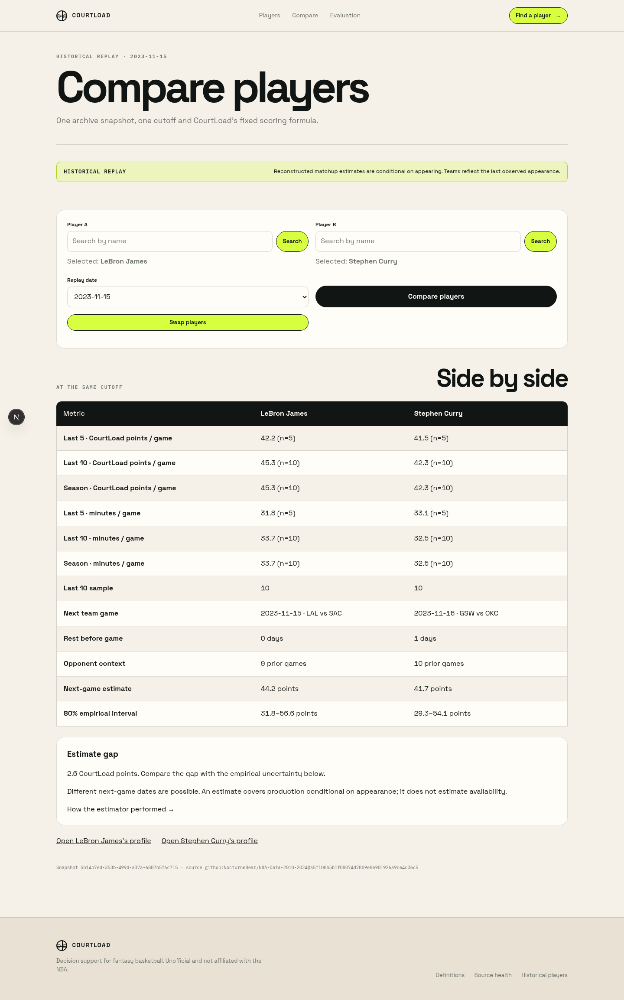
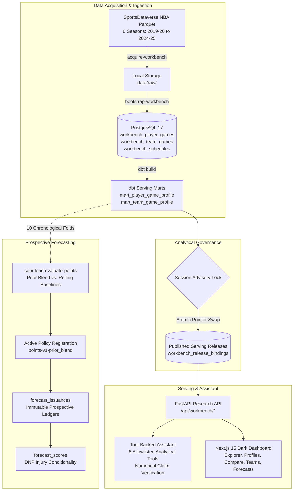

# CourtLens — Local NBA Research & Forecast Workbench

**Current stage:** the Databallr replica is in progress. B35a/B35b retained operations,
original content and installable metadata are verified; real Gemini language evaluation,
actual OS installation, changing Live-game observations and deeper source/model gates
remain open. See the [current capability ledger and measured evidence](docs/databallr-replica-implementation-progress.md).
The historical figures and milestone table below describe earlier workbench evidence,
not current source coverage or full replica acceptance.
The [assistant revamp progress](docs/assistant-revamp-progress.md) records AR01–AR07's measured
boundaries. AR08's live holdout was opened and stopped on Gemini quota after 2/90 planned runs;
final live acceptance remains incomplete. See the [acceptance evidence](docs/evidence/ar08-acceptance/README.md).

CourtLens is an engineer's local NBA research and forecasting workbench engineered with strict temporal discipline, source-traceable box-score lineage, out-of-time machine learning evaluation, and an optional tool-backed analytical assistant.

Operating on six complete NBA regular seasons (2019–20 through 2024–25) and prospective 2025–26 schedules, CourtLens turns 104,533 player-game records into reproducible cohort explorations, multi-team trade stint reconciliations, contextual opponent metrics, calibrated empirical forecast intervals, and verified natural-language answers.



> **Demonstration & Walkthrough:** A comprehensive step-by-step user journey across Explorer, Profiles, Comparisons, Forecasting Ledger, Assistant, and Disaster Recovery is documented in [docs/evidence/workbench-demo-walkthrough.md](docs/evidence/workbench-demo-walkthrough.md).

---

> **Naming:** the project was renamed from CourtLoad to CourtLens on 2026-10-06. The Python package, `courtload` CLI, `COURTLOAD_*` environment variables, database and Docker service names keep the old identifier until a separate internals rename; historical evidence keeps its original names so recorded hashes verify.

## 1. What Is Built

- **Comprehensive NBA Historical & Prospective Scope:** 104,533 normalized player-game facts, 7,924 team-game facts, and 5,470 schedules across 6 complete regular seasons plus 2025–26 prospective schedules.
- **dbt Warehouse & Serving Layer:** 39 layered dbt models and schema tests building staging (`stg_`), intermediate facts (`fct_`), and analytical serving marts (`mart_`).
- **Atomic Pointer Publication & Safe Rollback:** Dedicated PostgreSQL session advisory locks protect candidate schema building, candidate validation, serving-row copy, and pointer swap. Rollback is atomic and non-destructive.
- **Strict Temporal Discipline:** Feature calculation strictly excludes target and future dates ($game\_date < replay\_date$). Replaying historical cutoffs reproduces profiles deterministically without future information leakage.
- **Prospective Points Forecasting & DNP Conditionality:** Out-of-time evaluation across 10 chronological folds with an active prior-blend model (MAE 4.88 vs. baseline MAE 5.09; 81.2% empirical 80% interval coverage). Features an immutable prospective issuance ledger (489 issuances, 489 scores) that strictly separates DNP injuries from 0-point appearances.
- **Tool-Backed Analytical Assistant:** Read-only analytical assistant backed by 8 allowlisted domain functions, strict input validation, loop bounds ($\le 4$ rounds, $\le 8$ tool calls, $\le 100$ rows), numerical tolerance claim verification ($\pm 0.05$), and a zero-cost deterministic offline fixture provider.
- **Reproducible Saved Investigations:** Persists parameterized research queries with cryptographic SHA-256 result digests, enabling one-click reproduction and JSON audit export.
- **Dense Dark Dashboard (Next.js 15):** High-density desktop and 375px mobile layouts featuring Player Explorer, Multi-Stint Player Profiles (e.g. Pascal Siakam's TOR/IND trade split), Head-to-Head Comparisons without forced winners, Team Research, Forecasting Ledger, and Ask CourtLens AI.
- **Complete Disaster Recovery:** Atomic backup and restore commands (`courtload backup-archive` / `courtload restore-archive`) coordinated under a PostgreSQL mutation lock, verified by automated restore testing against fresh disposable databases.

---

## 2. Portfolio Highlights & Resume Evidence

- **Data Engineering:** Built a local NBA research workbench using Python 3.14, PostgreSQL 17, and dbt, versioning 104,533 player-game records across 6 NBA seasons and exposing reproducible player/team investigations with upstream transform lineage.
- **Offline ML & Forecasting:** Evaluated next-game points baselines and challengers across 10 chronological holdout folds, reporting an active prior-blend MAE of 4.88 (vs. baseline 5.09) with 81.2% empirical interval coverage; implemented immutable prospective forecast logging separating DNP injuries from 0 PTS appearances.
- **AI Systems & Guardrails:** Built and evaluated a read-only NBA query assistant with independent SQL oracles across 150 frozen questions; measured an initial Gemini development baseline of 253/360 exact answers (70.28%) and correctness changes on 3/120 repeated questions (2.5%). Final holdout acquisition remains incomplete on provider quota. [Measured case study](docs/evidence/ar08-acceptance/README.md).
- **Performance & Reliability:** Benchmarked 15 FastAPI endpoints under concurrency with median latencies under 55 ms for core research views and 0.0% error rate across 450 requests.

### Assistant case study: server-owned answers, measured language planning

An ordinary question about last season's assists leader failed when the planner proposed an old
season despite the server having resolved the current calendar. The revamp makes server scope
authoritative, permits one validation repair, and keeps analytical values tied to executed result
cells. General basketball explanations carry a visible source label; generated narratives pass a
numeric checker before streaming and otherwise retain the template answer. The chat page and
contextual player/team panel preserve durable threads, saved findings and manual analysis.

The frozen evaluation contains 120 development and 30 holdout questions, each repeated three
times, with expectations computed independently against a pinned PostgreSQL snapshot. The
[initial live development baseline](docs/evidence/ar02-evaluation/README.md) measured 70.28%
exact-answer accuracy and 91.04% strict canonical plan agreement. Those figures predate routing
and narrative changes and are not the current implementation's final accuracy. Recorded provider
responses replay offline in pytest; fixture/browser checks establish execution and presentation.

The [AR08 live holdout capture](docs/evidence/ar08-acceptance/live-holdout.json) contains an
incorrect clarification followed by a quota failure: 0/2 acquired turns passed, with 88 planned
turns unacquired. No holdout tuning or retry was performed. Holdout accuracy across all questions,
flakiness and the live narrative fallback rate remain unmeasured. Desktop/mobile screenshots,
verification logs and reproduction steps are in the [acceptance report](docs/evidence/ar08-acceptance/README.md).

---

## 3. Project Status and Milestones

The table below preserves historical foundational/workbench milestone reports. Their completion prose is not fresh runtime verification; the replica progress log records current measured boundaries and remaining gates.

| Milestone | Scope / Deliverable | Status | Evidence Document / Artifact |
| :---: | :--- | :---: | :--- |
| **P1** | Clean Local Environment Bootstrap | **Complete** | Idempotent setup, verified package locks, `.env` contract |
| **P2** | Multi-Season Acquisition & Validation | **Complete** | 6 complete seasons (104,533 player games, 7,924 team games, 5,470 schedules) |
| **P3** | Daily Worker & In-Season Catch-Up | **Complete** | Ingestion pipeline, mutation lock, freshness tracking |
| **P4** | dbt Warehouse & Unified Marts | **Complete** | 39 dbt models & tests passed in 1.93s, zero warnings |
| **P5** | Dense Dark Dashboard & Explorer | **Complete** | Explorer, multi-stint profiles, head-to-head comparison, 375px mobile verified |
| **P6** | Points Forecasting Offline Evaluation | **Complete** | 10 chronological folds, active `points-v1-prior_blend` (MAE 4.88, coverage 81.2%) |
| **P7** | Prospective Issuance & Scoring Ledger | **Complete** | 489 prospective issuances, 489 scores, explicit DNP conditionality |
| **P8** | Tool-Backed Assistant & Guardrails | **Complete** | 8 allowlisted tools, evidence citations, offline fixtures, smoke suite passed |
| **P9** | Evidence Package & Disaster Recovery | **Complete** | [Case studies](docs/evidence/workbench-case-studies.md), [Performance](docs/evidence/performance.md), [Walkthrough](docs/evidence/workbench-demo-walkthrough.md), [Disaster Recovery](tests/integration/test_restore_postgres.py) |

---

## 4. Architecture



---

## 5. Quick Start

### Option A: Local Python & Dashboard (Recommended)

Prerequisites: Python 3.12+ (Python 3.14 tested), Node.js 20+ (Node.js 24 tested), Docker (for PostgreSQL 17).

```bash
# 1. Clone repository and install dependencies
git clone https://github.com/ethioking/courtload.git
cd courtload
python3 -m venv .venv
source .venv/bin/activate
pip install -e ".[dev]"
npm --prefix dashboard install

# 2. Start PostgreSQL container & run migrations
docker compose up -d db
courtload migrate

# 3. Bootstrap 6-season workbench dataset & build dbt marts
courtload acquire-workbench
courtload bootstrap-workbench
dbt build --project-dir warehouse --profiles-dir warehouse --select tag:workbench

# 4. Evaluate points forecasting & issue prospective forecasts
courtload evaluate-points
courtload issue-forecasts
courtload score-forecasts

# 5. Start backend API and frontend dashboard
courtload serve --port 8000 &
npm --prefix dashboard run dev -- -p 3000
```

Open <http://localhost:3000> in your browser.

### Optional Gemini connection

Set `COURTLOAD_GEMINI_API_KEY` in the ignored root `.env` and set
`COURTLOAD_GEMINI_MODEL` to a model your AI Studio project can access (the example
uses the locally evaluated `gemini-3.5-flash-lite`). The owner's installation uses a Free-tier
project. Confirm Free in Google AI Studio's Billing Tier column; CourtLens cannot enforce
Google's billing tier. Normal usage follows Google's project/model quotas rather than a
CourtLens daily call allowance. Quota exhaustion shows a useful response without switching
to a paid provider; a timeout remains a separate failure.
[Google quota rules](https://ai.google.dev/gemini-api/docs/rate-limits),
[billing-tier verification](https://ai.google.dev/gemini-api/docs/billing#verify-billing-status).

Other users can supply their own paid Gemini key through the same configuration, at their
own expense. Other vendors require a compatible adapter; arbitrary API keys are not currently
interchangeable. The core/manual workflows require no paid provider. Local Python reads `.env`; Compose passes
these settings only to the API. Restart the local API or recreate the Compose
API after changing them. The dashboard never receives the key.

Run the existing opt-in evaluation with a new evidence path:

```bash
.venv/bin/python scripts/evaluate_b34_conversation.py \
  docs/evidence/gemini-evaluation-NEW.json --real-provider --project-tier free
```

It stops on provider errors, quota or timeout and records model/version,
token usage, latency and per-case results. A configured key alone does not
establish language accuracy. See [connection evidence and provider review criteria](docs/evidence/gemini-setup-2026-10-04.md).

PF07d's hybrid evaluation uses `scripts/evaluate_pf07d_hybrid.py --real-provider` with a
new output path and a dated nonsecret Free-tier confirmation via `--free-project-evidence`.
It runs the finite frozen corpus and stops at the first provider failure. No separate
call-count authorization is required; `--max-calls` is an optional smoke-test stop.

The owner-approved Lite configuration passes the [B34c language acceptance](docs/evidence/b34c-language-acceptance.md):
45 core cases, twelve additional paraphrases and six finance/empty-season cases. Failed
probes, quota/capacity observations and remaining capability gates are retained there.

---

## 6. Operations & Disaster Recovery

### Create Backup Bundle under Mutation Lock
```bash
./scripts/backup.sh
# Bundles PostgreSQL dump, raw parquet inputs, evaluation configs, points-v1 artifacts,
# and saved investigations into data/backups/courtload-backup-<TIMESTAMP>.tar.gz
```

### Restore to a Target Database
```bash
./scripts/restore.sh data/backups/courtload-backup-<TIMESTAMP>.tar.gz
```

### Automated Restore Verification
```bash
courtload verify-restore
# Verifies database relations, artifact checksums, live player profile queries, and forecast ledgers
```

### Performance Benchmarking
```bash
.venv/bin/python scripts/benchmark_workbench.py
```

---

## 7. Data and Model Guardrails

- **Zero Information Leakage:** Historical queries operate strictly prior to the requested cutoff date (`game_date < replay_date`).
- **DNP Conditionality:** Absent box-score rows (DNP due to injury or rest) are recorded as unobserved, never fabricated into 0 PTS.
- **Empirical Uncertainty:** Predictions serve calibrated 80% empirical intervals; overlapping intervals never compute synthetic "win probabilities".
- **Defensive Modeling Honesty:** CourtLens serves exact box-score event totals (steals, blocks, rebounds) and rejects composite "best defender" impact ratings.
- **Deferred Out-of-Scope Forecasting:** Requests for conference-winner or championship forecasts return typed `model_not_available` explanations with factual team standings.
- **Zero-Cost Core:** The full research workbench, including the assistant via deterministic offline fixtures, operates 100% locally without external API dependencies.

---

## 8. Repository Structure

```text
├── src/courtload/         # Application core (API, CLI, ingestion, services, models)
│   ├── api/               # FastAPI routers (/api/workbench/*), OpenAPI schemas
│   ├── evaluation/        # Points forecasting runner, baselines, prior blend, calibration
│   ├── ingestion/         # SportsDataverse parquet ingestion, streaming normalization
│   └── services/          # Workbench analytics, assistant orchestration, backup/restore
├── warehouse/             # dbt models (staging, intermediate facts, serving marts, schema tests)
├── dashboard/             # Next.js 15 App Router web application
│   ├── app/               # Routes: /players, /players/[id], /compare, /teams, /forecasts, /analyses
│   ├── components/        # Explorer, comparison tables, assistant panel, lineage modal
│   └── e2e/               # Playwright browser test suite
├── docs/                  # Architectural documentation, decisions, and evidence
│   ├── assets/            # Screenshots and demonstration video
│   ├── evidence/          # Measured benchmarks, case studies, demo walkthrough, checksums
│   └── operations/        # Operations runbook, backup, and restore procedures
├── evaluation/            # Evaluation configurations and manifests
├── migrations/            # Alembic schema versions
├── scripts/               # Backup, restore, benchmarking, and smoke test scripts
└── tests/                 # Unit, integration, PostgreSQL contract, and disposable DB restore tests
```

---

## 9. License

CourtLens is open-source software licensed under the [MIT License](LICENSE).

The dashboard bundles Public Sans and JetBrains Mono locally. Their font files retain
their own copyright and license notices under [dashboard/public/fonts](dashboard/public/fonts/manifest.json).
See [B36 production typography acceptance](docs/evidence/b36b-typography-acceptance.md)
for the selected files and measured loading/rendering checks.
