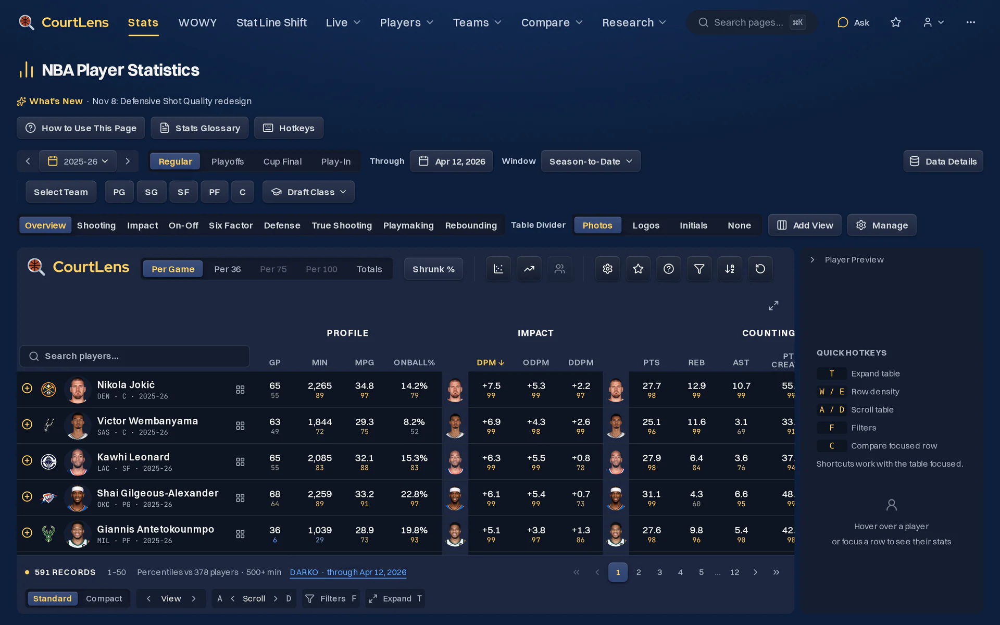
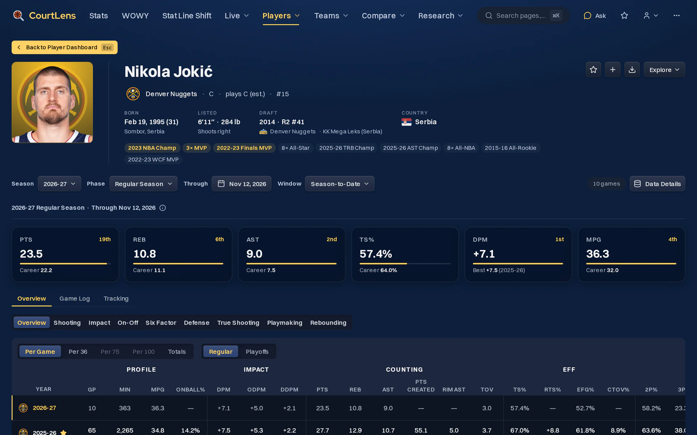
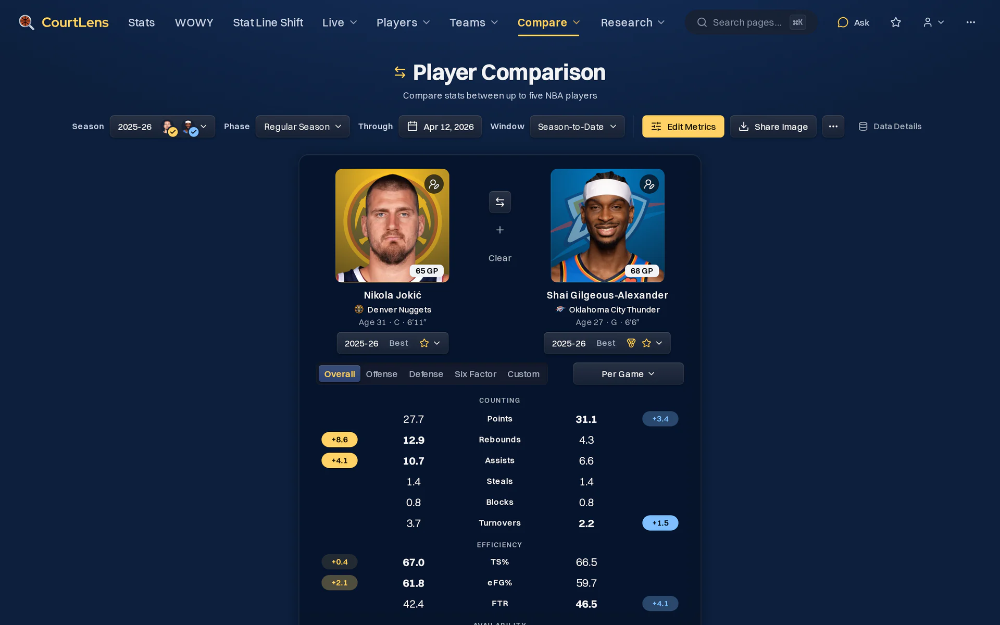
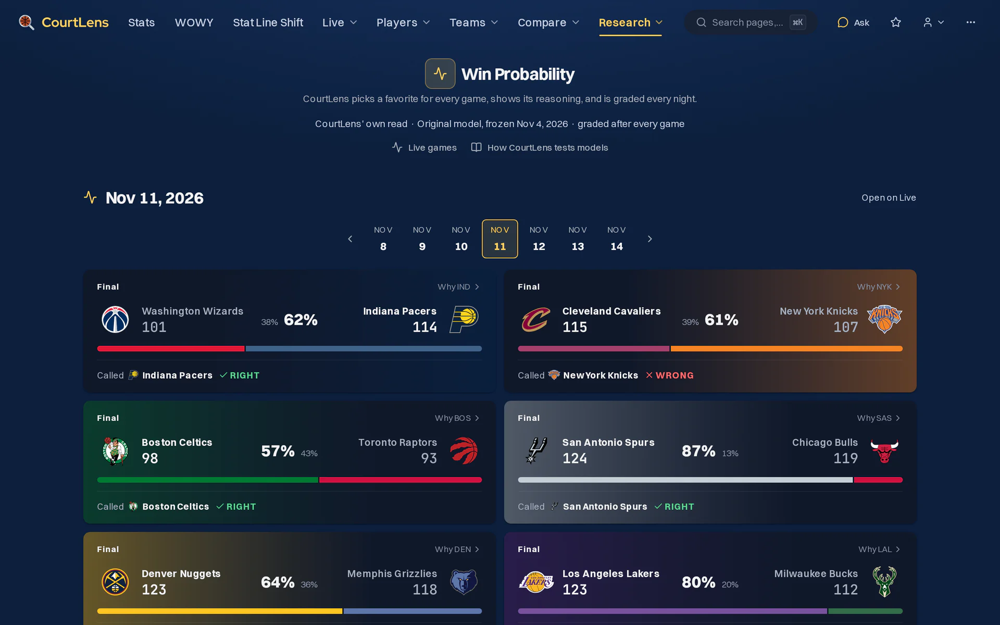
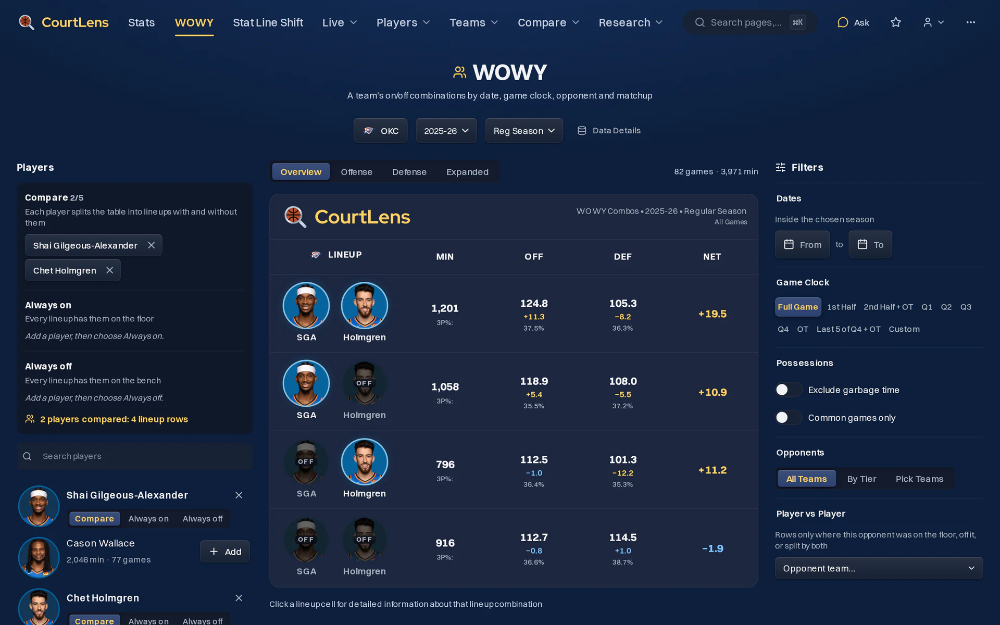
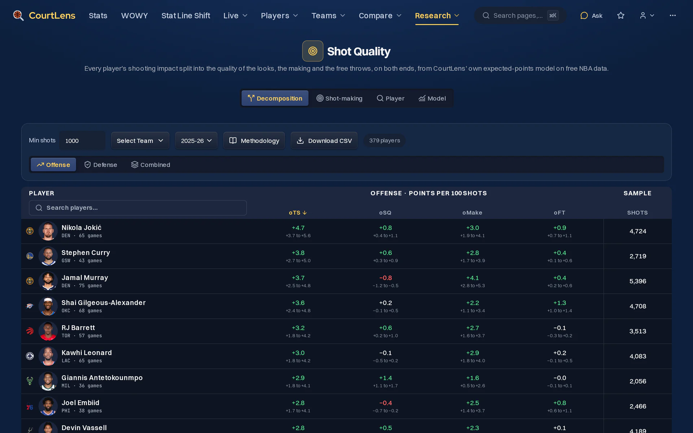
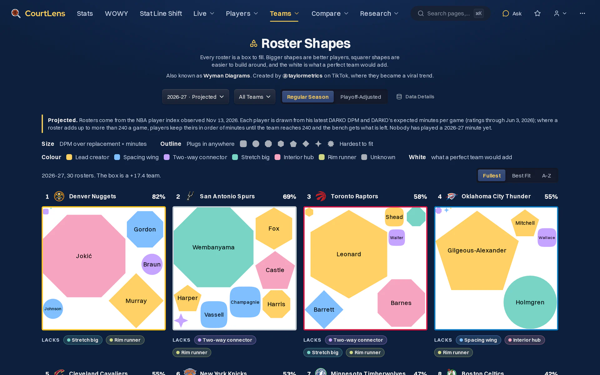
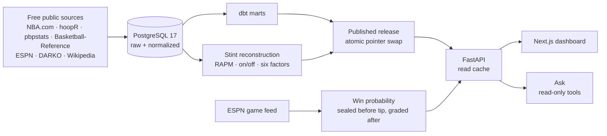

#  CourtLens

[](https://github.com/calebhabesh/courtlens/actions/workflows/ci.yml)
[](LICENSE)

CourtLens is a self-hosted NBA analytics site. It covers every season since 1946-47. It computes
its own player impact ratings from public play-by-play and tests its models on seasons they never
saw. Its win probability model calls every game before tip-off and is graded after the final. The
data sits in a versioned PostgreSQL and dbt warehouse behind a FastAPI service and a Next.js
dashboard, whose design draws heavily on [Databallr](https://databallr.com) ([credits](#credits)).
A tool-calling assistant answers questions from the warehouse.

**Live site: <https://courtlens.calebhabesh.com>**

<p align="center">
  
</p>

## Status

Finished on 2026-11-13. CourtLens is a non-commercial portfolio project. The live site serves
every page read-only. Signing in (email and password, Google, or the shared demo account) adds
favorites and Ask, with a few questions a day. One free-tier VPS runs the site and every scheduled
data job: rosters every six hours, a daily refresh, weekly impact fits, and win probability seals
before each tip-off with grading after each final ([deployment guide](docs/deployment.md)). Every
page was designed against its reference-site counterpart ([catalog](docs/alignment-catalog.md)).
The assistant's held-out evaluation (Research R16) was cut by the owner before it finished, so no
holdout accuracy is claimed.

Design rules:

- **No future data:** features only use games before the replay date, so
  changing a later game can't change an earlier result.
- **Missing isn't zero:** an absent box score is unknown, not a 0-point game or an injury.
- **Releases are immutable:** raw inputs are content-hashed. Releases go live by
  an atomic pointer swap, so a failed rebuild never replaces the last good one.
- **Free data only:** every source is free, and a page whose data isn't free is removed.

## What's on the Site

| Menu | What you get |
| --- | --- |
| **Stats** | Every player in one table: per game, per 36, per 75, per 100 or totals, with league percentiles. Nine preset views plus your own. Any season since 1946-47, cut at any date. Trend charts across seasons. |
| **Players** | A page for every player: bio, honors, career table, impact ratings, contracts, transactions, career highs, game log and tracking. Also Last X Games, Showcase player cards with a season slideshow, Player Twins (the closest player-seasons since 1996-97) and Player Dashboard. |
| **WOWY · Stat Line Shift** | How a team plays with and without up to five players, filtered by date, game clock, opponent and garbage time. How a player's stat line shifts when a teammate sits. |
| **Live** | Scores, box scores, play-by-play, shot charts and win probability for each game, plus the playoff bracket and series pages. |
| **Teams** | Team pages with ratings and six factors, standings, Roster Shapes, salary cap sheets and a free-agency tracker. |
| **Compare** | Up to five players side by side, two team seasons, and who guarded whom from NBA tracking. |
| **Research** | Win Probability, Projected Impact, Lineup Model, Six-Factor RAPM, Metric Backtest, Shot Quality, zTS, Shot Aftermath, Defensive Shot Quality, Signal vs Noise, Points Forecasts, Learning, Combine & Wingspan, Draft Classes, an ORtg calculator and Patch Notes. Each model page says what was registered before fitting and how it scored on unseen seasons. |
| **Ask** | A chat assistant that answers from the warehouse with read-only tools, links the players and teams it names, and keeps each account's conversations. |

Across the site: search covers every page, player and team (⌘K). Every player, team, game and
series name links to its page. Each view's Data Details panel names its sources and dates. Views
export as share images, and signed-in accounts keep favorite players.

<table>
  <tr>
    <td width="50%" valign="top">
      
      <br><b>Player pages</b>: bio, honors, ranked stat cards and the career table, followed by impact, contracts and transactions.
    </td>
    <td width="50%" valign="top">
      
      <br><b>Player Comparison</b>: up to five players across any seasons, with the leader of each stat marked.
    </td>
  </tr>
  <tr>
    <td width="50%" valign="top">
      
      <br><b>Win Probability</b>: every game's call is sealed before tip-off, then graded against the final score.
    </td>
    <td width="50%" valign="top">
      
      <br><b>WOWY</b>: every on/off combination of up to five teammates, with filters for game clock, opponent and garbage time.
    </td>
  </tr>
  <tr>
    <td width="50%" valign="top">
      
      <br><b>Shot Quality</b>: shooting impact split into the quality of the looks, the making and the free throws, each with an 80% interval.
    </td>
    <td width="50%" valign="top">
      
      <br><b>Roster Shapes</b>: every roster as shapes in a box. Bigger shapes are better players, and the white is what a perfect team would add.
    </td>
  </tr>
</table>

## How It Fits Together



Python 3.12 (FastAPI, SQLAlchemy 2.0, Pydantic), PostgreSQL 17, dbt, scikit-learn, Next.js 16
with TypeScript, and Docker Compose. The site runs on an arm64 Oracle Always Free VPS behind Caddy
and a Cloudflare tunnel.

## Results

Research results, each registered before fitting and tested on seasons the
model never saw ([Research progress](docs/research-progress.md)):

- **Win probability (R15):** log loss 0.4028 against 0.4157 for the baseline on
  2,439 test games in 2024-25 and 2025-26, calibration error 0.0083
  ([evidence](docs/evidence/research/r15a/README.md)). Frozen and graded after
  every 2026-27 game, beside a market-informed model (v4) on the same seals
  ([v4 progress](docs/win-probability-v4-progress.md)).
- **Metric backtest (R08):** with ratings fixed before each of 11,979 games
  (2016-17 to 2025-26), monthly time-decay RAPM predicts the margin +0.80 points
  better in RMSE (+0.72 to +0.88) than team net rating, the only metric ranked
  above every other ([evidence](docs/evidence/research/r08/README.md)).
- **Projected Impact (R07):** CourtLens' own player rating beats carrying last
  season forward by +4.38 (+3.25 to +5.50) in minutes-weighted squared error on
  2024-25 and 2025-26 ([evidence](docs/evidence/research/r07/README.md)).
- **Shot Quality v2 (R05):** the expected-points shot model's Brier score is
  2.56% better (2.44% to 2.67%) than league zone and distance rates on 2024-25
  and 2025-26 ([evidence](docs/evidence/research/r05/README.md)).
- **Ask evaluation (R16):** cut before it finished (owner, 2026-11-13); no number.

The earlier points forecast protocol was superseded by the frozen points-v1 evaluation (MAE 4.643,
80.6% interval coverage); the boosted challengers failed their gates and the baseline was kept.

## Explore the Project

| Area | Contents |
| --- | --- |
| [`src/courtlens/`](src/courtlens/) | FastAPI app, CLI, ingestion, impact metrics, models, assistant |
| [`warehouse/`](warehouse/) | dbt staging, fact and serving models |
| [`dashboard/`](dashboard/) | Next.js App Router dashboard |
| [`evaluation/`](evaluation/) | Forecast evaluation configs and manifests |
| [`docs/architecture.md`](docs/architecture.md) | System design |
| [`docs/source-contract.md`](docs/source-contract.md) | Data sources and their rules |
| [`docs/research-progress.md`](docs/research-progress.md) | Every Research model: registration, results and evidence |
| [`docs/design/design-language-v1.md`](docs/design/design-language-v1.md) | The dashboard's design language |
| [`docs/operations/runbook.md`](docs/operations/runbook.md) | Setup, refresh, backup and restore |
| [`docs/deployment.md`](docs/deployment.md) | The hosted site: Compose stack, scheduled jobs and deploys |

## Run Locally

You need Docker, Python 3.12+ and Node.js 20+.

```bash
make install && make install-dashboard
cp .env.example .env
docker compose up -d db && make migrate
courtlens bootstrap        # acquire data, build dbt models, publish a release
make dev                   # API on :8000
npm --prefix dashboard run dev
```

Ask works without an API key in a limited rule-based mode. For full answers, set a free Gemini or
Groq key in `.env`. Anthropic and OpenAI keys work too. Keys stay on the server. Google sign-in
and email sign-up are optional and need their own keys. `make test`, `make lint` and
`make typecheck` run the checks. The [runbook](docs/operations/runbook.md) covers everything else.

## Credits

CourtLens takes heavy inspiration from [Databallr](https://databallr.com) and
the work of its creator. Databallr's pages were the visual reference for nearly
every CourtLens page, and several Research pages rebuild ideas first published
there (the Six-Factor RAPM framework, zTS, the ShotQuality RAPM decomposition,
Shot Aftermath and Roster Shapes) on CourtLens' own data. Wherever the code,
docs or pages say "the reference site" they mean Databallr, and "the draft
site" means its companion site, Draftballr.

CourtLens computes its own numbers from free public data. The only Databallr
figures it shows are the published first-chance attempt counts that Shot
Aftermath compares its own counts against.

Data comes from NBA.com, the SportsDataverse hoopR archive, pbpstats, Basketball-Reference, ESPN,
DARKO (Kostya Medvedovsky's model) and Wikipedia (CC BY-SA). Each view names its own sources, and
the full list is in [source policy v3](docs/design/source-policy-v3.md).

## License

[MIT](LICENSE). Bundled fonts keep their own licenses, listed in
[`dashboard/public/fonts`](dashboard/public/fonts/manifest.json). The Switzer interface font is
not in the repository (its license excludes redistribution); install, dev and build fetch the
hash-pinned original from Fontshare. CourtLens is
unofficial and not affiliated with the NBA.
