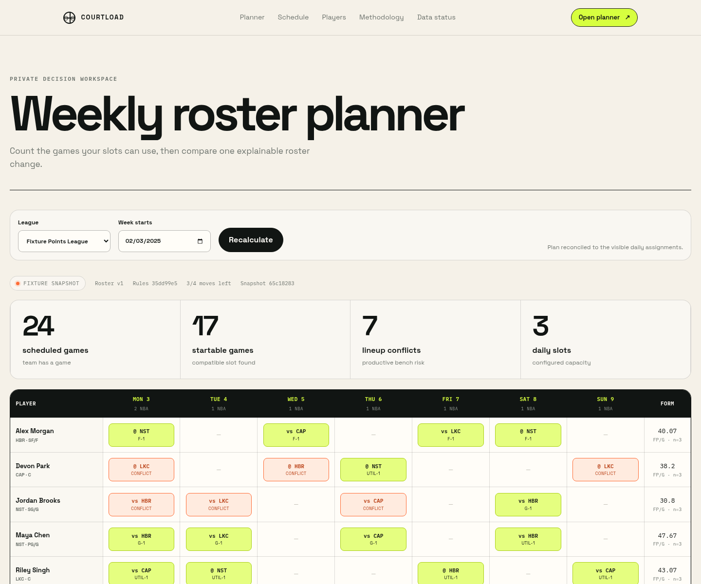
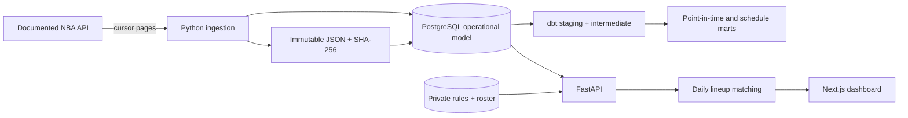

# CourtLoad — NBA Fantasy Week Planner

CourtLoad answers a deceptively hard fantasy-basketball question: **how many of my roster's games
can I actually fit into this week's active lineup slots?** It combines a documented NBA data
source, traceable ingestion, tested warehouse models, private league rules, and deterministic daily
matching to distinguish scheduled games from startable games.

The product deliberately stops short of pretending to know whether a player is healthy, available
on waivers, or guaranteed to play. It is an unofficial planning aid, not a transaction bot,
injury feed, betting tool, or replacement sports-data API.



> The screenshots and default demo use fictional, deterministic provider-shaped fixtures. The UI
> and API label them `FIXTURE`; they are not represented as current or historical NBA records.

## What is built

- A bounded BALLDONTLIE adapter with API-key authentication, cursor pagination, client-side rate
  limiting, bounded retries, schema validation, and explicit authentication/entitlement failures.
- Immutable, content-addressed raw JSON snapshots with SHA-256 checksums and source-object lineage.
- Idempotent PostgreSQL loading that accepts legitimate game/stat corrections without duplicating
  source identities and reconstructs observed player/team stints.
- A dbt warehouse with explicit grains, two-sided team-game expansion, weekly team schedules,
  configurable reference scoring, and point-in-time rolling features ending one row before the
  current game.
- A FastAPI service with Argon2id passwords, expiring JWTs, owner-scoped leagues/rosters/watchlists,
  public schedule and player-form views, status/methodology endpoints, metrics, and OpenAPI docs.
- A deterministic maximum-cardinality lineup matcher with flex-slot eligibility, recent-form
  tie-breaking, stable output, visible conflicts, league-local dates, and persisted add/drop
  scenarios evaluated against the same snapshot and rules.
- A responsive Next.js dashboard for the public schedule, player form, weekly planner, what-if
  comparison, methodology, and current data/quality status.
- Alembic migration, Docker Compose environment, operational quality checks, backup/refresh/smoke
  scripts, CI, dependency updates, security guidance, and architecture/decision records.

## Honest project status

The engineering path is complete and verified against deterministic fixtures. Two important pieces
of real-world evidence require the project owner's account and fantasy workflow and are therefore
not fabricated here.

| Area | Status | Evidence |
| --- | --- | --- |
| Source contract and release guardrails | Complete | [Source contract](docs/source-contract.md), checked 2026-08-23 |
| Ingestion, corrections, lineage, and entitlement behavior | Fixture/contract verified | Python tests and immutable raw snapshots |
| PostgreSQL and analytics warehouse | Verified | Alembic upgrade plus 10 dbt models and 62 passing tests |
| API, private ownership, planner, and scenario workflow | Fixture verified | Integration tests and running container smoke checks |
| Responsive dashboard | Fixture verified | Production build, component tests, desktop/mobile captures |
| Live provider viability spike | **Pending API credentials** | No `BALLDONTLIE_API_KEY` was available; see [evidence checklist](docs/evidence/README.md) |
| Two real fantasy scoring weeks | **Pending user workflow** | Must be recorded without publishing private league details |
| Optional ML evaluation | Intentionally not started | No model is promoted; v1 uses transparent descriptive form |

This distinction matters: CourtLoad will fail clearly when credentials or paid player-stat
entitlements are missing. It never replaces failed operational ingestion with generated NBA data.

## Planner semantics

For each league-local day, CourtLoad:

1. Finds roster players whose observed/current team has a non-cancelled game.
2. Preserves that as a **scheduled player-game**, even if the manager marks the player inactive.
3. Excludes only user-entered inactive/IR states from lineup assignment; it does not infer health.
4. Expands configured slots such as `PG`, `G`, `F`, and `UTIL` into individual slot instances.
5. Finds the maximum-cardinality player-to-slot matching using user-supplied eligibility.
6. Uses trailing fantasy production strictly before the week as a transparent tie-break, then
   stable player/slot IDs for deterministic output.
7. Labels eligible but unmatched players as **lineup conflicts** and explains the constraint.

An add/drop what-if applies from the selected effective date, preserves the earlier roster,
respects the acquisition limit, reruns the same matcher, and reports separate changes in scheduled
games, startable games, conflicts, and same-cutoff descriptive form. It does not execute a
transaction or claim the candidate is available.

## Architecture



The browser never receives provider credentials or raw payloads. See
[architecture and lineage](docs/architecture.md) for grains, boundaries, and failure semantics,
and [ADR 0002](docs/decisions/0002-daily-matching.md) for the matching decision.

## Quick start with labeled fixtures

Requirements: Docker with Compose v2. Port `5432` is used by PostgreSQL, `8000` by the API, and
`3000` by the dashboard.

```bash
cp .env.example .env
docker compose up --build -d db migrate api
docker compose exec api courtload seed-demo
docker compose up --build -d dashboard
```

Open:

- Dashboard: <http://localhost:3000>
- Interactive API docs: <http://localhost:8000/api/docs>
- Prometheus metrics: <http://localhost:8000/metrics>

The fixture planner uses week `2025-02-03` and signs into its local demo account only while the
active data classification is `fixture`:

```text
demo@courtload.dev
CourtLoad-demo-2026
```

If port 3000 is occupied, start the dashboard on another host port and keep CORS aligned:

```bash
COURTLOAD_DASHBOARD_PORT=3100 docker compose up --build -d api dashboard
```

Resetting the database is explicit and disabled in production:

```bash
docker compose exec api courtload seed-demo --reset
```

## Use operational provider data

Review [the source contract](docs/source-contract.md), create a provider key, and set
`BALLDONTLIE_API_KEY` in the untracked `.env`. Teams, players, and games were documented on the
Free tier when checked; full-game player stats required NBA ALL-STAR or higher. Entitlements,
prices, terms, and rate limits can change and must be rechecked before deployment.

Recreate the API after changing its environment, migrate, then ingest a deliberately bounded
window:

```bash
docker compose up -d --force-recreate migrate api
docker compose exec api courtload ingest \
  --start 2026-08-01 \
  --end 2026-08-07 \
  --include-players \
  --include-stats
docker compose exec api courtload quality
docker compose --profile tools run --rm dbt build --profiles-dir .
```

Run the identical ingest twice for the viability gate. The second run should contain unchanged
objects unless the provider published a legitimate correction. Record coverage, request count,
tier/cost, zero-minute versus absent-row behavior, one correction/reschedule, and timing in
`docs/evidence/live-source-spike.md` before describing the source as operational in a portfolio.

## Development and verification

Local development requires Python 3.12+ and Node.js 24. The checked-in lockfile makes the frontend
install reproducible.

```bash
make install
make install-dashboard
cp .env.example .env
alembic upgrade head
courtload seed-demo
```

Run the complete checks:

```bash
ruff format --check .
ruff check .
mypy src/courtload
pytest --cov=courtload --cov-report=term-missing
npm --prefix dashboard run lint
npm --prefix dashboard run typecheck
npm --prefix dashboard test
npm --prefix dashboard run build
docker compose --profile tools run --rm dbt build --profiles-dir .
./scripts/smoke.sh
```

Useful operations:

```bash
./scripts/refresh.sh       # rolling correction window, quality-aware dbt build
./scripts/backup.sh        # compressed PostgreSQL dump; 14-day local retention
docker compose down        # stop services without deleting named volumes
```

The refresh job retains earlier lawful snapshots if a paid stats entitlement expires and reports
the failure instead of masking stale form as fresh. The deployment checklist and restore procedure
are in the [operations runbook](docs/operations/runbook.md).

## API surface

Public reads:

| Method | Endpoint | Purpose |
| --- | --- | --- |
| `GET` | `/api/health` | API and database liveness |
| `GET` | `/api/data-status` | Classification, freshness, coverage, last run, and quality checks |
| `GET` | `/api/schedule/week?start=` | League-local schedule, light slates, and back-to-backs |
| `GET` | `/api/players?query=` | Source-backed player search |
| `GET` | `/api/players/{id}/form?asOf=&window=` | Time-correct trailing production |
| `GET` | `/api/lineage/player-games/{sourceStatId}` | Raw-object checksum and dbt path without raw payloads |
| `GET` | `/api/methodology` | Machine-readable definitions and caveats |
| `GET` | `/api/models/runs` | Explicit no-promoted-model decision |

Authenticated, owner-scoped workflow:

| Method | Endpoint | Purpose |
| --- | --- | --- |
| `POST` | `/api/auth/register`, `/api/auth/token` | Account and bearer token |
| `POST/GET` | `/api/fantasy/leagues` | Create/list private rule configurations |
| `PUT/GET` | `/api/fantasy/leagues/{id}/roster` | Idempotent manual roster import |
| `PUT/GET` | `/api/fantasy/leagues/{id}/watchlist` | Candidate list without availability claims |
| `PUT` | `/api/fantasy/leagues/{id}/weeks/{weekStart}` | Acquisition use and manager-confirmed statuses |
| `GET` | `/api/fantasy/leagues/{id}/planner?weekStart=` | Reconciled weekly grid |
| `POST/GET` | `/api/fantasy/leagues/{id}/scenarios` | Persisted same-snapshot add/drop comparison |

Cross-owner private resources return `404`, so the API does not disclose whether another user's
league or scenario exists.

## Repository map

```text
src/courtload/           ingestion, models, scoring, matching, services, API, CLI
migrations/              Alembic schema migration
warehouse/               dbt staging, intermediate models, marts, and tests
dashboard/               Next.js App Router dashboard and component tests
tests/                   unit, contract, integration, temporal, and ownership tests
fixtures/provider/       small documented-schema contract fixtures
docs/                    source contract, architecture, ADRs, evidence, and runbook
scripts/                 refresh, backup, and smoke automation
.github/                 CI and dependency-update configuration
```

## Data and model guardrails

- `operational`: fetched lawfully from the configured documented provider.
- `fixture`: fictional deterministic correctness/demo data.
- `synthetic load`: reserved for labeled capacity tests; none is shipped in v1.
- Missing player-stat rows remain unknown; a DNP is represented only when the provider reports a
  row/state that supports it.
- Point-in-time windows exclude the current game. A regression test changes a current stat line
  and confirms its own prior feature/form does not move.
- Scoring rules are validated, normalized, hashed, and stored with leagues and scenarios.
- Weekly-lock leagues, platform scraping, inferred injuries, automatic lineups/transactions, and
  speculative multi-move optimization are explicitly unsupported.
- V1 accepts at most 12 active daily slots, keeping the auditable slot-mask matcher predictably
  bounded for authenticated requests.
- ML is optional and gated on out-of-time improvement over a strong rolling baseline. No untested
  projection is exposed merely to add an ML feature.

## Current limitations and next evidence

The remaining work is empirical, not hidden behind a “production-ready” label:

1. Run and document the credentialed 25+ completed-game source spike.
2. Use a private real roster/watchlist for two scoring weeks and record one clarified decision and
   one limitation that still required the fantasy platform.
3. Measure repeatable backfill/incremental duration and API p50/p95 on the target deployment.
4. Only then evaluate optional next-game models with rolling out-of-time splits and publish a
   negative result if they fail the go/no-go bar.

See [the evidence checklist](docs/evidence/README.md). Do not convert fixture results into claims
about real NBA coverage or user outcomes.

## More documentation

- [Source contract and provider terms decision](docs/source-contract.md)
- [Architecture, lineage, grains, and failure semantics](docs/architecture.md)
- [Planner-before-ML decision](docs/decisions/0001-planner-before-ml.md)
- [Daily matching decision](docs/decisions/0002-daily-matching.md)
- [Operations and restore runbook](docs/operations/runbook.md)
- [Contributing](CONTRIBUTING.md) and [security policy](SECURITY.md)

CourtLoad is MIT-licensed software. Provider data remains subject to its provider's terms. NBA and
team marks are not bundled; CourtLoad is not affiliated with or endorsed by the NBA.
