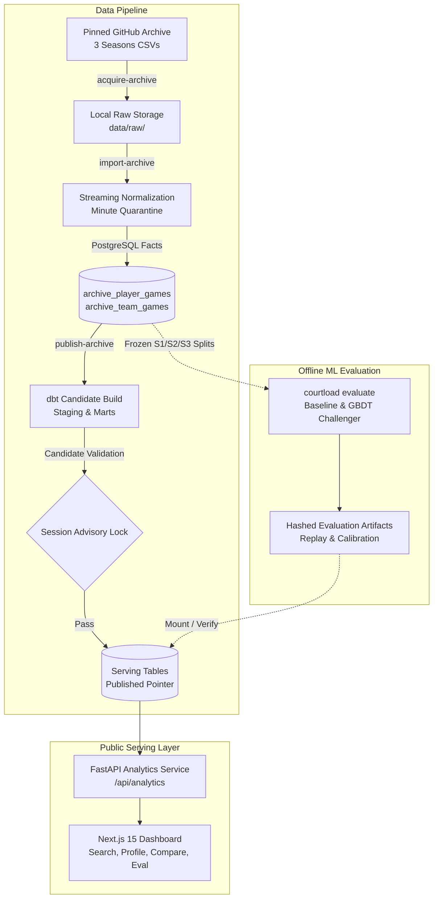

# CourtLoad — NBA Player Comparison & Analytics

CourtLoad is a source-traceable NBA player intelligence and two-player comparison platform engineered with strict temporal discipline, a reproducible analytical warehouse, and transparent offline machine learning evaluation.

Operating on three complete historical NBA regular seasons (2021–22, 2022–23, and 2023–24), CourtLoad turns raw box scores and schedules into multi-window player summaries, minutes and attempt trends, reconstructed opponent allowances, and—when validated out of time—calibrated empirical prediction intervals.


> **Demonstration:** A 25-second walkthrough video of the interactive user journey (Search $\rightarrow$ Profile $\rightarrow$ Compare $\rightarrow$ Evaluation) is available at [docs/assets/demo.webm](docs/assets/demo.webm).

---

## 1. What Is Built

- **Pinned Historical Archive Acquisition:** Pinned retrieval of 4 canonical CSV files (73.9 MB total) from `NocturneBear/NBA-Data-2010-2024` with verified SHA-256 checksums and immutable file locators.
- **Idempotent Ingestion & Strict Normalization:** Streaming parser handling 3,511 admitted games, 7,022 team-game facts, and 90,609 player-game facts. Strict `m:ss` minute validation quarantines 184 `:60` malformed rows and 179 affected games as atomic units. Preserves explicit numeric zeros distinct from missing counts and date-only precision without inventing tipoff times.
- **dbt Analytical Warehouse & Serving Marts:** 25 models and schema tests building player facts, team facts, 220,942 dated player profiles across 485 replay cutoffs, and 14,447 dated opponent contexts.
- **Atomic Pointer Publication & Safe Rollback:** Dedicated PostgreSQL session advisory locks protect candidate schema building, candidate validation, serving-row copy, and pointer swap. Rollback is atomic and non-destructive.
- **Frozen Offline Machine Learning Experiment:** Dataset-bound evaluation runner with separate leakage-safe features and labels, 7-day calendar block purging, and rolling baselines (Last-10, EWMA-20). M6 GBDT challenger evaluation on the S3 holdout resulted in an honest **Do Not Promote** decision (failing 3 of 4 frozen gates), keeping the negative result visible and serving the winning EWMA-20 baseline.
- **FastAPI Public Analytics API:** Resolves the mutable publication pointer once per request, serving dataset-pinned profiles, paginated cursor-bound game logs, two-player comparison in matchup context, and verified evaluation reports. Benchmarked at **79.66 ms p50** for two-player comparisons with **0.0% error rate**.
- **Responsive Next.js 15 Dashboard:** Interactive Player Explorer with autocomplete search, player detail with trend charts, side-by-side comparison with differing target dates and empirical intervals, and transparent evaluation and data health views. Keyboard accessible and verified at a 375 px viewport with no horizontal overflow.
- **Complete Disaster Recovery:** Atomic backup and restore scripts bundling PostgreSQL dump, raw archives, manifests, and evaluation artifacts, validated by an automated verification command (`courtload verify-restore`).

---

## 2. Honest Project Status

All milestones **M0 through M8 are complete and evidenced**. The project meets all portfolio readiness criteria without requiring paid third-party API dependencies or cloud hosting spend.

| Milestone | Area | Status | Evidence Document / Artifact |
| :---: | :--- | :---: | :--- |
| **M1** | Historical Source Acquisition | **Complete** | [Historical source spike](docs/evidence/historical-source-spike.md) (95.1% coverage, 184 quarantined rows) |
| **M2** | Immutable Archive & Safe Migration | **Complete** | Alembic `8ffd4c5912e2`, 90,609 player facts, idempotent re-import |
| **M3** | Warehouse & Atomic Publication | **Complete** | [Real player analytics](docs/evidence/real-player-analytics.md) (LeBron James M3 reconciliation) |
| **M4** | Player Detail & Replay Controls | **Complete** | [Desktop profile](docs/assets/real-player-profile.png), [Mobile profile](docs/assets/real-player-profile-mobile.png) |
| **M5** | Frozen Baseline Evaluation | **Complete** | [Baseline evaluation](docs/evidence/baseline-evaluation.md) (EWMA-20 MAE 7.7095 vs. Last-10 7.8264) |
| **M6** | Challenger & S3 Final Test | **Complete** | [Model card](docs/evidence/model-evaluation.md) (No-promotion decision: 3 of 4 gates failed) |
| **M7** | Two-Player Comparison & Evaluation | **Complete** | [Comparison & evaluation](docs/evidence/comparison-evaluation.md), [Desktop](docs/assets/real-comparison.png), [Mobile](docs/assets/real-comparison-mobile.png) |
| **M8** | Historical Case Studies | **Complete** | [Case studies](docs/evidence/case-studies.md) (Thomas Bryant role surge; Chris Paul vs. Scottie Barnes) |
| **M8** | Performance Benchmarking | **Complete** | [Performance evidence](docs/evidence/performance.md) (Pipeline timings, storage, API p50/p95) |
| **M8** | Interactive Demo Recording | **Complete** | [Demonstration recording](docs/assets/demo.webm) (25s, 1280x720 25fps WebM) |
| **M8** | Backup & Restore Recovery | **Complete** | `scripts/backup.sh`, `scripts/restore.sh`, `courtload verify-restore` |

> *Note on legacy features:* BALLDONTLIE ingestion and the fantasy weekly planner are preserved as historical functionality and labeled fixture workflows; they do not gate baseline completion.

---

## 3. Architecture



---

## 4. Quick Start

### Option A: Packaged Docker Compose (Recommended)

Requires Docker with Compose v2.

```bash
# 1. Setup environment
cp .env.example .env

# 2. Start services (PostgreSQL, migrations, API, and Dashboard)
docker compose up --build -d db migrate api dashboard

# 3. Verify health
curl -f http://localhost:8000/api/health
```

If port 3000 is in use, set `COURTLOAD_DASHBOARD_PORT=3100` in `.env` and restart.

- **Dashboard:** <http://localhost:3000>
- **API Documentation:** <http://localhost:8000/api/docs>
- **Metrics:** <http://localhost:8000/metrics>

### Option B: Local Python & Node Setup

Prerequisites: Python 3.12+, Node.js 24, PostgreSQL 17.

```bash
# 1. Install dependencies
make install-locked      # installs exact pinned Python packages from requirements-lock.txt
make install-dashboard   # installs exact frontend dependencies from package-lock.json

# 2. Run migrations
alembic upgrade head

# 3. Build & publish historical archive
courtload acquire-archive
courtload import-archive
courtload publish-archive

# 4. Start local development servers
./scripts/dev-live-backend.sh
./scripts/dev-live-frontend.sh
```

---

## 5. Operations & Disaster Recovery

### Data Pipeline Commands

```bash
# Download/verify pinned historical archive
courtload acquire-archive

# Ingest and normalize facts into PostgreSQL
courtload import-archive

# Execute dbt build and atomically publish ready snapshot
courtload publish-archive

# Roll back to a previous snapshot without downtime
courtload rollback-publication <SNAPSHOT_ID>
```

### Offline Evaluation

```bash
# Run frozen baseline evaluation (S1/S2 splits + calibration)
make evaluate

# Run challenger grid search and open S3 holdout
make evaluate-final
```

### Backup and Restore

```bash
# Create complete backup bundle (database, manifests, artifacts, raw data)
./scripts/backup.sh
# -> Created ./data/backups/courtload-backup-<TIMESTAMP>.tar.gz

# Restore to target database and verify all invariants
./scripts/restore.sh ./data/backups/courtload-backup-<TIMESTAMP>.tar.gz

# Verify restored integrity and live comparison reconciliation
courtload verify-restore
```

### Performance Benchmarking

```bash
# Run repeatable API latency benchmark across 8 primary endpoints
python scripts/benchmark_api.py
```

---

## 6. Verification & Test Suite

The test suite enforces mathematical reconciliation, temporal isolation, and contract integrity:

```bash
# Python unit, integration, and PostgreSQL contract tests
pytest -v

# Static analysis and linting
ruff check .
ruff format --check .
mypy src/courtload

# Frontend tests (Vitest + Playwright)
npm --prefix dashboard test
PW_CHROMIUM_PATH=$(command -v chromium) npm --prefix dashboard run test:browser

# Production build check
npm --prefix dashboard run build
```

---

## 7. Data and Model Guardrails

- **Zero Information Leakage:** Historical replay operates strictly as of the start of the NBA game date in `America/New_York` (`game_date < replay_date`). Future box scores and same-day outcomes are excluded from feature calculation.
- **Absence Is Not Zero:** An absent box-score row is treated as unknown, not zero. Missing scoring inputs leave targets unavailable rather than asserting a scoreless appearance.
- **Empirical Uncertainty Over Spurious Precision:** CourtLoad serves calibrated 80% empirical intervals. Overlapping intervals never produce an invented "win probability" or automated start/sit recommendation.
- **Unpromoted Models Stay Visible:** When the M6 gradient-boosted challenger failed out-of-time promotion gates, CourtLoad retained the baseline EWMA policy and made the negative experimental outcome prominently visible on the Evaluation view.
- **Independent Provenance:** Underlying NBA game statistics originate from the pinned NocturneBear archive and are processed under strict schema validation. CourtLoad is an unofficial analytical tool and is not affiliated with or endorsed by the NBA.

---

## 8. Repository Structure

```text
├── src/courtload/         # Application core (API, CLI, ingestion, services, models)
│   ├── api/               # FastAPI routers, OpenAPI schemas, middleware
│   ├── evaluation/        # Offline ML runners, baselines, GBDT challenger, calibration
│   ├── ingestion/         # Bounded archive acquisition, streaming normalization
│   └── services/          # Player analytics, publication state machine, backup/restore
├── warehouse/             # dbt models (staging, intermediate facts, serving marts, tests)
├── dashboard/             # Next.js 15 App Router web application
│   ├── app/               # Routes: /players, /players/[id], /compare, /evaluation
│   ├── components/        # Player search, comparison tables, trend charts
│   └── e2e/               # Playwright browser tests and demo recorder
├── docs/                  # Architectural documentation, decisions, and operations
│   ├── assets/            # Screenshots and demonstration video (demo.webm)
│   ├── evidence/          # Measured evidence for all completed milestones (M1–M8)
│   └── operations/        # Operations runbook, backup, and restore procedures
├── evaluation/            # Frozen evaluation configuration and accepted dataset manifests
├── migrations/            # Alembic schema versions (legacy, archive facts, publication)
├── scripts/               # Backup, restore, benchmarking, and demo recording scripts
└── tests/                 # Unit, integration, and PostgreSQL contract test suite
```

---

## 9. License

CourtLoad is open-source software licensed under the [MIT License](LICENSE).
