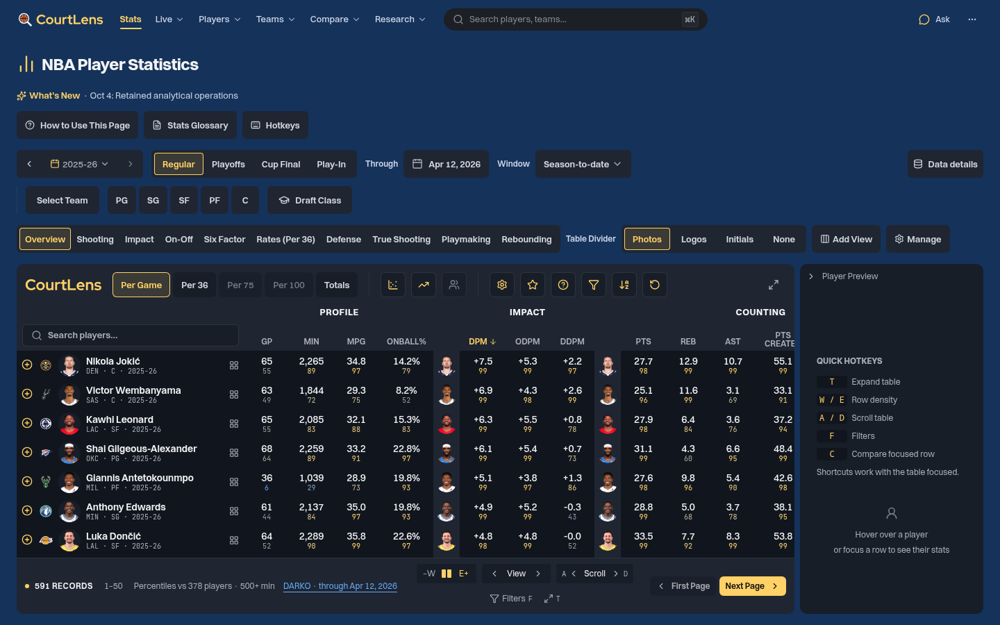
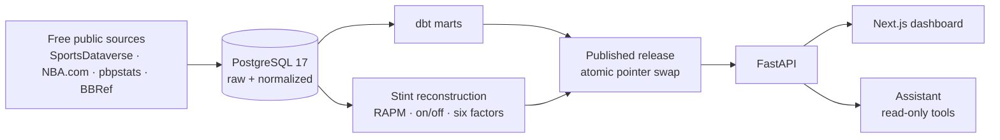

# CourtLens

CourtLens is a self-hosted NBA analytics site. It's a versioned PostgreSQL and
dbt warehouse, player impact ratings computed from public play-by-play,
out-of-time forecast evaluation, and a Next.js dashboard modeled on
[Databallr](https://databallr.com). A tool-calling assistant answers questions
from the warehouse, and its numbers are checked against real query results.

<p align="center">
  
</p>

## Status

This is a working portfolio project, not a hosted product. The warehouse,
impact metrics, forecasting and dashboard all run locally. Page-by-page
alignment with Databallr is in progress ([catalog](docs/databallr-alignment-catalog.md)).
The assistant's held-out evaluation stopped on a provider's free-tier quota,
so no holdout accuracy is claimed.

Design rules:

- **No future data:** features only use games before the replay date, so
  changing a later game can't change an earlier result.
- **Missing isn't zero:** an absent box score is unknown, not a 0-point game or an injury.
- **Releases are immutable:** raw inputs are content-hashed. Releases go live by
  an atomic pointer swap, so a failed rebuild never replaces the last good one.

## How It Fits Together



## Results

- **Forecasting:** across 10 chronological folds, the prior-season blend scored
  MAE 4.88 points against a rolling baseline's 5.09. 81.2% of outcomes landed
  inside the 80% interval ([case studies](docs/evidence/release-case-studies.md)).
- **Assistant:** on a pinned snapshot, the first Gemini development baseline got
  70.3% of 360 runs exactly right, checked against independently written SQL
  ([evaluation](docs/evidence/ar02-evaluation/README.md)).
- **API:** median under 55 ms for core views, with 0 errors in 450 concurrent
  requests ([performance](docs/evidence/performance.md)).

## Explore the Project

| Area | Contents |
| --- | --- |
| [`src/courtlens/`](src/courtlens/) | FastAPI app, CLI, ingestion, impact metrics, assistant |
| [`warehouse/`](warehouse/) | dbt staging, fact and serving models |
| [`dashboard/`](dashboard/) | Next.js App Router dashboard |
| [`evaluation/`](evaluation/) | Forecast evaluation configs and manifests |
| [`docs/architecture.md`](docs/architecture.md) | System design |
| [`docs/source-contract.md`](docs/source-contract.md) | Data sources and their rules |
| [`docs/operations/runbook.md`](docs/operations/runbook.md) | Setup, refresh, backup and restore |

## Run Locally

You need Docker, Python 3.12+ and Node.js 20+.

```bash
make install && make install-dashboard
cp .env.example .env
docker compose up -d db && make migrate
courtlens bootstrap        # acquire data, build dbt models, publish a release
make dev                   # API on :8000
npm --prefix dashboard run dev
```

The assistant works without an API key in a limited rule-based mode. To use a
model, set a Gemini, Anthropic or OpenAI key in `.env`. Keys stay on the
server. `make test`, `make lint` and `make typecheck` run the checks. The
[runbook](docs/operations/runbook.md) covers everything else.

## License

[MIT](LICENSE). Bundled fonts keep their own licenses, listed in
[`dashboard/public/fonts`](dashboard/public/fonts/manifest.json). CourtLens is
unofficial and not affiliated with the NBA.
