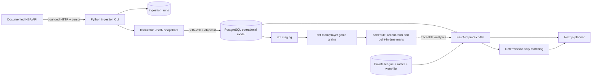

# Architecture and lineage



## Runtime boundaries

- The ingestion client owns provider authentication, rate limiting, cursor pagination, bounded
  retries, schema validation, and visible entitlement failures.
- `RawStore` canonicalizes each source object, calculates SHA-256, and writes it atomically to a
  content-addressed path before a transformed row points to it.
- Operational SQLAlchemy tables preserve source IDs, lineage, observed team stints, corrected game
  state, user-owned configuration, versioned scenarios, and quality runs.
- dbt owns analytical grains, default-formula reference scoring, two-row team-game expansion,
  weekly schedule marts, and pregame rolling windows ending at one preceding row.
- FastAPI owns authentication/authorization, public derived reads, user configuration, and scenario
  persistence.
- PostgreSQL product sessions use repeatable-read isolation, so a before/after scenario cannot see
  two different concurrent ingestion commits inside one request.
- A public player-game lineage view exposes only object/checksum/schema metadata and the retained
  dbt model path. Stored provider payloads remain outside the web root and are never proxied.
- The matching engine is pure Python and deterministic. It maximizes cardinality first, recent-form
  weight second, and stable IDs last.
- Next.js owns presentation only. Provider credentials and raw payloads never enter the browser.

## Primary grains

| Relation | Grain |
| --- | --- |
| `ingestion_runs` | one provider job attempt |
| `raw_objects` | one content version of one fetched source object |
| `dim_teams` | one provider team identity |
| `dim_players` | one provider player identity |
| `bridge_player_observed_team_stints` | one contiguous observed team stint |
| `fct_games` | one NBA game |
| `fct_player_games` | one provider full-game player stat row |
| `int_team_games` | two team-perspective rows per game |
| `mart_player_point_in_time_features` | one player/game pregame feature row |
| `mart_team_week_schedule` | one team/reporting week |
| `fantasy_roster_entries` | one player on one private league roster |
| `planner_scenarios` | one immutable add/drop calculation |

## Failure semantics

- Successful pages commit independently. A later paid-stat failure does not erase already stored
  teams or games; the run itself is marked failed.
- Network timeouts and 5xx responses use bounded exponential retry. Persistent 429, authentication,
  entitlement, and schema errors fail visibly.
- An identical content version reuses its raw object and leaves transformed rows unchanged.
- A changed source object creates a new raw version and updates the corresponding source-backed row.
- Stale or unavailable player form does not remove the schedule explorer. It is shown as stale or
  unavailable rather than silently refreshed from fixtures.

## Metric trace example

A recent-form game in `GET /api/players/{id}/form` retains `source_stat_id`, `source_object_id`, and
a link to `GET /api/lineage/player-games/{sourceStatId}`. The trace publishes the immutable object's
SHA-256 and schema version, then names the executable warehouse path:

```text
raw_objects
  -> operational.fct_player_games
  -> stg_player_games
  -> int_player_games_scored
  -> mart_player_point_in_time_features / mart_player_recent_form
  -> recent-form API and planner tie-break
```

The API and dbt mart calculate from the same retained player-game grain. The runtime API does not
depend on a completed dbt job, so loss of the analytics build does not take down the basic planner;
dbt remains the independently tested analytical/reconciliation layer.
