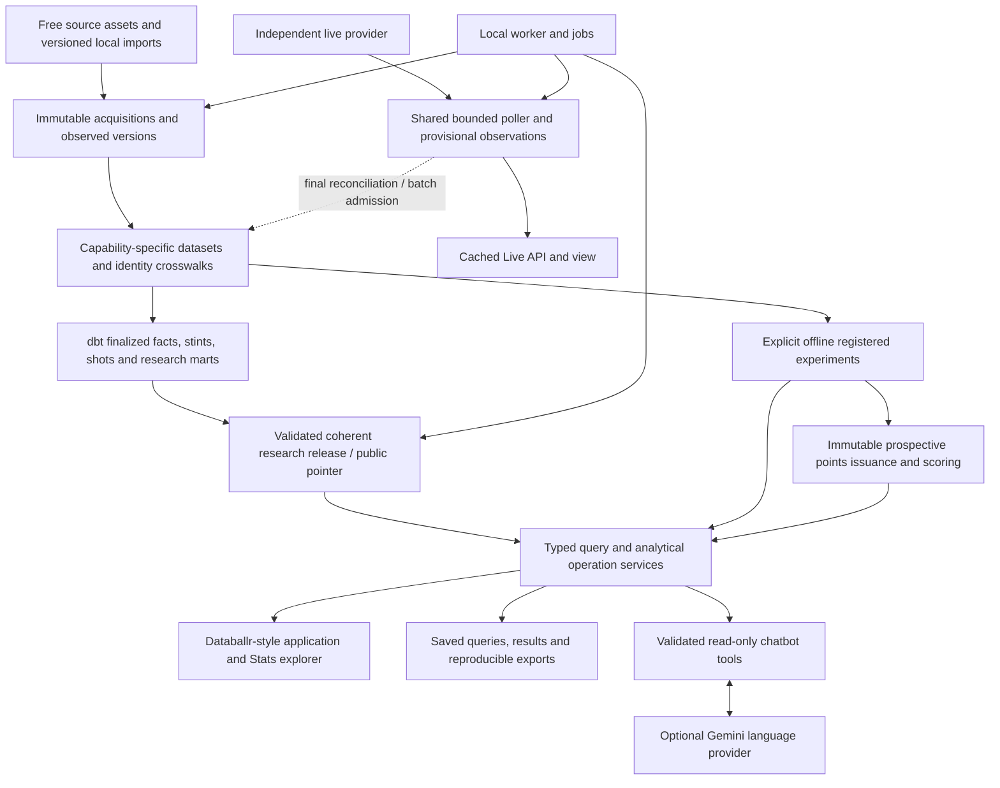

CourtLoad was renamed to CourtLens on 2026-10-07; identifiers below are historical.

# CourtLoad: Databallr replica and analytical expansion handoff

Prepared 2026-10-01. **Owner-confirmed product direction; implementation pending.**

Build a close functional and visual replica of the applicable NBA parts of Databallr, then integrate CourtLoad's engineering, forecasting, evidence, and conversational analysis. This is the next product handoff, not a claim that its capabilities already work. Planning changed documentation only; application checks were not rerun.

For the owner-confirmed polish/freeze phase, follow the [freeze handoff](polish-freeze-implementation-plan.md) and its linked contracts. It supersedes only explicitly revised UI/assistant behavior; retain this plan's analytical contracts, coverage ledger and unresolved source gates.

## Start here

1. Read root and dashboard `AGENTS.md`, then this plan. Begin with B00; do not restart the historical M0–M8 or workbench P0–P9 milestones.
2. Read the contract linked to the selected block. Inspect actual implementation before adding or replacing it.
3. Execute one bounded block, record its evidence in [replica progress](databallr-replica-implementation-progress.md), and hand off at a verified boundary.
4. Keep existing application edits and retained historical experiments intact. Planning baseline revision: `0864909c282d450baf6afad361e2500cc4501ddf`, with dirty application paths recorded below.

| Reference | When required |
| --- | --- |
| [Feature and interface contract](design/replica-feature-contract.md) | Routes, navigation, tables, plots, boards, finance/Live presentation, visual fidelity |
| [Analytical and data contract](design/replica-analytics-contract.md) | Queries, schemas, metrics, richer sources, models, finance, Live worker, publication |
| [Search and chatbot contract](design/replica-search-contract.md) | Incremental lookup, natural-language planning, conversation, budgets, evidence, evaluation |
| [Databallr reference inspection](research/databallr-replica-findings.md) | What was actually observed, authenticated-feature limits, methods, finance and Live details |
| [Free-source feasibility](research/replica-free-source-feasibility.md) | Acquisition candidates and the distinction between available files and admitted data |
| [Yahoo analysis findings](research/yahoo-basketball-analysis-findings.md) | Transferable analytical jobs and NBA versus other-sport restrictions |
| [Gemini findings](research/gemini-chatbot-findings.md) | Verified function-calling/free-tier facts; credential choices are deferred |
| [Fontshare findings](research/fontshare-interface-findings.md) | Later typography decision, numeral behavior and packaging conditions |

The [previous workbench handoff](workbench-implementation-plan.md), its [data contracts](design/workbench-data-contracts.md), and [points protocol](design/points-forecast-protocol.md) remain authoritative for retained evidence and existing forecasting behavior. This handoff supersedes their narrower product scope and sidebar-first layout. It explicitly admits new work on PBP/on-off, shots, experimental impact analysis, contracts, free agency, and separately sourced Live views. Their temporal, missingness, immutable evidence, local deployment, publication/rollback, and safe-operation rules remain binding.

## Confirmed product decisions

| Decision | Requirement |
| --- | --- |
| Foundation | Close Databallr replica, not merely a dashboard with similar colors. Recreate applicable NBA workflows and interactions across Stats through Research. |
| Main screen | `/stats` is the main workspace; `/` resolves to it. Compact horizontal application/navigation rows replace the rail. |
| Breadth | Player/team research, WOWY/on-off, comparisons, similarity, personal rankings/tier lists, research tools, measurements, contracts/free agency, Live and playoff context are in the roadmap. |
| Additions | Changing production/workload, historical distributions, rest/venue/opponent context, saved evidence, lineage, pipelines, points forecasts and model evaluation. |
| History | Target 2000–01 onward; validate recent inputs before backfill. Declare coverage separately per metric/source/phase. Partial careers are explicitly partial. |
| Analytical parity | An explicitly named CourtLoad alternative can satisfy a reference workflow when exact external metrics cannot be admitted. It does not inherit that external metric's identity or measured performance. |
| Similarity | Begin with recent statistical production/workload, explain the dimensions, and add shot/style variants after their inputs pass admission. |
| Chatbot | Multi-turn conversational natural-language analysis using the owner's Gemini key. Numerical answers come from CourtLoad tools/data. No web grounding in the first release. |
| Incremental lookup | Results while typing, independent of model calls and expensive statistical aggregation. |
| Live | Genuine in-progress updates, approximately 60-second active-view polling, bounded and shared between clients. |
| Finance | Include contracts/free agency. Prefer verified free automation; versioned CSV imports and documented manual corrections are accepted working paths. |
| Cost/deployment | Core has no paid dependency and works locally without AI. Use eligible free-tier AI configuration and quota handling; no automatic paid fallback. Internet hosting/accounts are outside this handoff. |
| Identity/type | Keep CourtLoad identity, use the reference's dense dark design language; Fontshare selection follows functional layout work. Credentials and final font choice remain deferred. |
| Exclusions | Databallr's Home game, WNBA/other-league products, external draft app, betting/odds, injury/appearance prediction, automatic start/sit, and a public social/consensus service. |

The NBA EPV workflow is catalogued as a future data-dependent research surface. The reference's ACB tracking demo is not an NBA dependency. Public-source access, machine-readable assets, currentness, reuse, and correctness are distinct gates. No provider or paid tier is presumed available because a reference page uses it.

## Architecture and reuse

Retain Python/FastAPI, PostgreSQL 17, SQLAlchemy, dbt, scikit-learn, Next.js/TypeScript and vanilla CSS. `dashboard/package.json` currently specifies Next.js `^16.3.5`; installed packages and bundled documentation govern implementation, not older Next.js 15 prose. Avoid framework migrations or a component-library rewrite.



One database and one local worker service remain sufficient. The worker may run a cooperative Live loop alongside one pipeline job using isolated sessions and bounded execution; a blocking dbt subprocess cannot stop Live heartbeats. Redis, Kafka, a vector database, a search cluster, and a second deployment platform are not prerequisites.

Keep deep module boundaries:

- Source adapters produce canonical observed facts; they do not compute dashboard metrics.
- The metric catalog/query services own computation; UI and AI reuse them.
- Query parsing, aggregation, paging, and full bounded-result export share semantics but have distinct output limits.
- UI view preferences and boards are mutable personal state; saved analytical evidence is immutable/versioned.
- Live owns provisional status and clock observations. It does not publish scores into forecasting facts on every poll.
- The provider adapter handles language/API transport; a server evidence renderer owns numerical answers and navigation.

Reuse acquisition/versioning, publication lock/pointer, registry, forecast ledger, investigation/export, media fallback, and API patterns. Extend focused modules instead of growing `workbench_analytics.py` into a universal source/query/model/finance service.

## Inspection baseline and first gates

These are static findings to verify in B00, not newly demonstrated runtime failures:

| Finding | Evidence/seam | Required correction |
| --- | --- | --- |
| Metric names/formulas disagree | `domain/metrics.py`, explorer options, metric catalog | Validate UI against catalog; add TS/eFG with new definitions, paired valid denominators and proper missingness. |
| Partial observations can become zero/incorrect means | `compute_metrics` initializes sums, divides by all appearances, sums makes/attempts independently | Per-metric valid samples, null when unknown, paired rows for ratios/rates; version changes. |
| Pagination stops at UI plumbing | Explorer sets cursor; page/API client omit it | Canonical serializer, API round trip and stable page traversal. |
| Saved result bound is clamped to 100 | Save/reproduce request export maximum; executor clamps all calls | Separate page and complete bounded-export iterators. |
| Reopened queries lose field names | Saved query snake_case versus route camelCase | One tested encode/decode contract, preserving context and filters. |
| Release context is lost | Rail/detail links and assistant request omit release; controls hardcode defaults | Pin context once and retain across navigation, queries, refresh and exports. |
| Lookup is expensive/submit-only | Ranking loads fact rows; name matching is substring only | Identity-only discovery service and incremental UI. |
| Assistant numerical binding is weak | Value-only matching, unverified claims retained, provider-written tables, first name match, heuristic explorer links | Typed plans, explicit entity resolution, server-owned result/evidence renderer and equivalent query navigation. |
| Completion prose overstates evidence | Workbench progress has inconsistent P9 status and code/prose differences | Preserve old logs; report current measured behavior in a new log. |
| Current outcomes are not acquired | 2026–27 source flags disabled; schedule-only evidence | Separate current-box source/refresh gate from worker existence. |

Pre-existing dirty work to preserve: `dashboard/components/player-portrait.tsx`, `scripts/dev-live-backend.sh`, `scripts/dev-live-frontend.sh`, `src/courtload/cli.py`, `src/courtload/services/workbench_jobs.py`, and untracked `tests/unit/test_portrait_jobs.py`. Reinspect Git status when implementation begins; this list is not a license to overwrite later changes.

## Delivery sequence and block ownership

**Sol** below means GPT-6.1 Sol at medium reasoning; **Flash** means Gemini 3.8 Flash. These are the owner's implementation agents, not models required by the product. Sol owns migrations/data/contracts/query/model/worker correctness. Flash owns bounded frontend slices after their contracts are fixed. A different available model may be used only as an explicitly recorded implementation choice, not as a silent product change.

Every block starts by reading its dependencies' actual evidence. Existing working behavior can satisfy a block through verification/reuse; do not rebuild it simply because it appears in this roadmap. A source gate with no suitable free input is `source_blocked`, not complete. Continue independent blocks and preserve the feature in the coverage ledger.

| Block | Owner | Prerequisites | Deliverable and owned seams | Completion evidence |
| --- | --- | --- | --- | --- |
| B00 Baseline/integrity inventory | Sol | None | New progress/evidence inventory; current runtime, revision/dirty work, actual checks, retained checksums, source/capability map. | Reproducible baseline; critical DB tests execute; each inspection finding confirmed or disproved; existing failures classified. |
| B01 Canonical context and query schemas | Sol | B00 | Context/query/view schemas, strict API validation, TS contract generation/check, URL serializer and compatible legacy mapping. | Encode/decode/refresh/navigation fixtures preserve release, phase, dates, scope, filters, sort and cursor; mismatches rejected. |
| B02 Metric integrity and catalog v2 | Sol | B01 | `domain/metrics.py` and focused domain modules; TS/eFG/FTR, valid totals/means/ratios/rates, units, sample validity, normalization and percentiles. | Independent arithmetic reconciliation; null/zero/paired-row tests; old experiment hashes unchanged; old saved metric versions remain reproducible. |
| B03 Bounded Stats query engine | Sol | B01–B02 | SQL/dbt aggregates and query service; predicates, selectable metrics/windows/seasons, paging, full-result export; query plan/performance harness. | Rankings/filter counts reconcile; every eligible row traverses once; >100-row save/export reproduces; measured query cost excludes full Python fact loading. |
| B04 Entity discovery API | Sol | B01 | Identity/alias index, `/lookup`, ranking rules and versioned cache. Read [search contract](design/replica-search-contract.md). | Names/aliases/diacritics/ambiguous identities and empty-season discovery pass; cardinality/payload/latencies recorded. |
| B05 Replica shell and navigation | Flash | B01 | Layout, top application row, horizontal menus, compact context controls, `/stats` entry and compatibility routes; semantic CSS tokens. | Desktop/narrow screenshots; keyboard menus, context-preserving links, no body overflow; legacy routes still resolve. |
| B06 Incremental global lookup | Flash | B04–B05 | Header combobox, keyboard navigation, grouped entity/route results, cancellation and bounded client cache; shared lookup component. | Incremental results and stale-response tests; typing does not call ranking or Gemini; measured browser latency meets target. |
| B07 Dense Stats explorer | Flash | B02–B03, B05 | Grouped/pinned headers, preset tabs, metric/sample filters, counting modes, sort/page, portrait modes, detail sidebar, density/fullscreen and action tray. | Real data agrees with API; correct empty/partial states; each preset uses admitted metrics; keyboard/narrow paths work. |
| B08 Personal state persistence | Sol | B01 | Additive models/API for versioned saved views, favorite IDs, comparison selections, tier/ranking boards and local workspace preferences. | Mutation boundaries, schema/metric validation, references, export/import and version conflicts tested; saved evidence remains separate. |
| B09 Views, favorites and boards UI | Flash | B07–B08 | Add/manage/reorder views, choose default, favorites, local tier/ranking board editing; keyboard alternatives to drag. | Reload/restore/export paths retain state; unsupported metrics survive as explicit unavailable choices; no fabricated public consensus. |
| B10 Charts and comparisons | Flash | B03, B07–B09 | Two-axis scatter, multi-player lines, comparison table/PvP, selectable definitions, chart data tables and context-labelled image exports. | Same query/context yields same values in chart/table/data/image exports; outliers/hover/focus and null handling correct. |
| B11 Player pages and showcase | Flash | B03, B05, B10 | Player dashboard/detail, recent-games page, season/multi-season/career views, cards/slideshow, forecast availability and lineage. | Two real players/traded player/rookie/no-target cases; incomplete careers labelled; portrait failures harmless. |
| B12 Trends, distributions, splits and similarity API | Sol | B02–B03 | Versioned analytical operations for disjoint period comparisons, quantiles, rest/venue/opponent summaries and statistical peers. | Golden computations, sample rules, no future leakage or hidden causal inference; selected similarity dimensions explain matches. |
| B13 Investigation tools UI | Flash | B10–B12 | Trend/distribution/split/peer views and Stats filters/result cards, saved questions, explicit definitions and samples. | Three agreed chatbot examples can also be answered manually; saved operations reopen to an equivalent view. |
| B14 Current finalized data, historical backfill and identity | Sol | B00–B03 | Separate B14a current finalized-box/schedule refresh and dated identity metadata, B14b resumable season batches toward 2000–01, and B14c measurements/draft metadata. | Current capability/corrections/daily catch-up evidenced separately from historical coverage/storage; no future identities alter prior ranking hashes; no false complete-career claims. |
| B15 Team analytical operations | Sol | B02–B03, B12 | Team production/allowance, box-score factors, explicit estimated-possession variants, historical team similarity and cohorts. | Independent final-team reconciliation, denominator/league-average rules, cutoffs and tie semantics; incomplete player boxes cannot erase valid team outcomes. |
| B16 Team explorer and comparison | Flash | B10, B14a, B15; B14b for backfilled peers | Team table/cards, factors, detail/cohort, two-team comparison and historical peers. | Reconciled Toronto investigation and two-team comparison; participation/current-roster distinction; no official seed inferred from record ties. |
| B17 Playoff/series data API | Sol | B01–B03, B14a; selected admitted postseason | Admitted postseason games, bracket/series identity and status, explicit seed evidence, completed-game series summaries. | Scheduled placeholders are not outcomes; phase-safe series aggregation; missing bracket/seed data explicit. |
| B18 Playoff interface | Flash | B05, B10, B17 | Bracket, series/detail/game cards, player/team series tables and capability-gated matchup/rotation panels. | Historical series with real facts; unplayed/partial/stale cases; playoff descriptive views do not issue unregistered playoff forecasts. |
| B19 Rich-source admission | Sol | B00–B02 | Bounded scripts/adapters for PBP, possessions, game lineups, shots, matchups and optional playtypes; one recent full season first. | Full source/identity/coverage/null/clock/score/shot checks; source bytes/parser signatures retained; every rejected game reported. |
| B20 Possession and stint warehouse | Sol | B19 | Event/possession/stint domain, reconstruction/override registry, dbt facts and cutoff-safe exposure aggregates. | Five-player sides, event order, overtime and minute/point conservation; explicit FT/substitution/possession policy; future mutation controls pass. |
| B21 On/off, WOWY and stat-shift API | Sol | B03, B20 | Shared-floor set predicates, exact units, on/off tables, teammate production shifts, optional declared leverage/shrinkage policy. | Independent set partitions and exposure reconciliation; min possessions/samples, query bounds and descriptive limitations verified. |
| B22 WOWY/on-off interface | Flash | B07, B10, B21 | WOWY team/leaders modes, players together/apart, unit builder, on/off Stats preset and teammate-shift page. | Small/large unit and empty-sample paths; displayed denominators/priors; comparison/save/export from the same operation. |
| B23 Shots, matchup and aftermath API | Sol | B03, B19–B20 | Zone/attempt/make facts, shooting-profile peers, assignment summaries and possession-sequence aftermath operations. | Coordinates/units and totals reconcile; missing coordinates unknown; guarding labels come from assignments; outcome branches follow declared policy. |
| B24 Shooting and matchup interface | Flash | B10, B23 | Shooting tabs/court plots, shot-profile twins, matchup matrix, shot-aftermath and verified source-video links with coverage. | Chart/table/replay evidence agrees; clip mapping/source unavailable states usable; no nearest-defender or tracking claim from shot coordinates alone. |
| B25 External outputs and model preregistration | Sol | B14a; B20/B23 and admitted history as each experiment needs | Legitimate DARKO/other output spike and versioned binding; protocols for CourtLoad RAPM/six-factor/expected-shot/playtype experiments. | Identity/observation date/reuse/version gates explicit; each experiment freezes splits, estimand, candidates, budget and acceptance before final evaluation. |
| B26 Registered research experiments | Sol | B25 and each protocol's data gates | Run independent sub-blocks for impact, six-factor, expected-shot and playtype-adjusted efficiency; artifact registry/model cards and API results. | Reproduction and chronological evaluation with baselines/errors/coverage, honest negative results; no imported output presented as locally trained. |
| B27 Advanced research surfaces | Flash | B10; B14c for measurements, B15/B20 for calculator, B25–B26 for model panels | Impact/player research, roster allocation diagrams, wingspan, hypothetical calculator and research dashboards. | Every coefficient/shape/calculator input has a definition, model/source identity and availability; unavailable vendor/spatial panels remain explicit. |
| B28 Contract/transaction acquisition and schema | Sol | B00–B01, B14a identity | Free-source spike, CSV template/import, provenance-bearing correction ledger, financial/association observations and release bindings. | Real bounded import with options/unknowns/crosswalk/corrections; no duplicate salary sums; manual fallback works without subscription. |
| B29 Finance query operations | Sol | B02–B03, B28; B25 for external value | Financial context, contracts/terms, known payroll/allocations/timeline, free-agent status and versioned optional value comparison. | Decimal/cents arithmetic, known-row coverage, scenario/option semantics and missing-term gates; totals and status groups reconcile. |
| B30 Contracts/free-agency UI | Flash | B05, B10, B29 | Contracts by team/year, drawers/timeline/allocation, Small vs Big, free-agent filters/status/source/terms and Refresh/import workflow. | Source-linked real import; unknown values remain unknown; incomplete payroll suppresses exact threshold claims; analytical/financial years distinct. |
| B31 Shared Live service | Sol | B00–B01, B14a identity | Provider spike, bounded view leases, single shared poller/cache, provisional observations, final reconciliation and status API. | Request-count/resource budgets and multi-client coalescing; status transitions/crosswalk/error/visibility cases; no publication/build/training per poll. |
| B32 Live interface | Flash | B05, B31; B18 for series links | Date strip, scores/clock/status, selected-game boxes, historical final-game detail and pause/stale/offline states. | Hidden/unmounted views expire demand; several tabs do not multiply upstream traffic; in-game evidence recorded when available. |
| B33 Conversational analytical backend | Sol | B01–B04, B12; later tools use their own gates | Typed intent/operation planning, entity/context resolution, conversations, tool budgets, evidence IDs, strict renderer and safe equivalent links. | Adversarial/missing/ambiguous/refinement tests; every number is server-owned and context-bound; no raw SQL/web tools; provider deadlines/cumulative limits enforced. |
| B34 Chatbot interface and query evaluation | Flash | B05, B13, B33 | Chat drawer/research page, follow-ups, clarification choices, result tables/charts/evidence/Open in Stats/save, configuration/quota states. | Manual/NL query equivalence corpus; fixtures plus bounded real-key evaluation when configured; AI disabled leaves manual workflows complete. |
| B35 Methodology, exports and integration | Sol then Flash, sequential | Implemented relevant blocks | Definitions/learning/blog/patch-notes from original project content, lineage, operations/settings, full saved-operation manifests, installable metadata and coherent cross-feature links. | All retained investigation types reproduce/open/export; install metadata/cache state verified; no build/train/download from read-only chatbot; source/model limitations visible. |
| B36 Fontshare refinement (optional) | Flash | B07, B10, B30, B34 | Compare verified font candidates at actual density; apply later owner selection with legitimate offline packaging. | Numerals/name glyphs/readability/zoom/CLS/asset hashes/licenses verified; existing font remains until selection. |
| B37 Release evidence and recovery | Sol | All claimed-complete blocks | Real-service browser acceptance, resource/latency/storage benchmarks, backup/fresh restore, case studies, README/demo and final capability ledger. | Requirements below evidenced; outstanding source/model gates listed; no claim of complete replica while applicable rows remain incomplete. |

### Working waves

Deliver a coherent application early without shrinking the final feature map:

1. **Foundation and visible replica:** B00–B11. After B04, Sol can develop B08/B12 while Flash works on B05–B07; freeze schema/client ownership first.
2. **Useful analysis and history:** B12–B18. B14 backfill proceeds in bounded batches alongside UI work; it never silently expands a frozen experiment.
3. **Richer analytics:** B19–B27. Source/warehouse correctness precedes WOWY, shooting and experimental outputs.
4. **Finance and Live:** B28–B32 are independent tracks after foundation. Finance is required scope, not an optional feature hidden behind a paid provider. Live intensity is measured independently.
5. **Chatbot and integrated release:** B33–B37. B33 may start once foundational operations are stable; add later operations only when their capabilities are admitted. Final credential/font decisions do not block manual core operation.

Block IDs establish dependencies, not a rule to wait for every smaller ID. Keep one owner for shared files: Sol owns API schemas/generated contracts and migrations; Flash consumes them. Schedule shared `types`, API client, global CSS and layout changes sequentially or through an agreed ownership handoff. Use isolated checkouts only when they help avoid concurrent edits; do not create multiple competing migrations or formula implementations.

B14 has three separately reviewable sub-blocks. B14a admits current finalized player/team boxes and schedule observations, replaces the hardcoded disabled-season source flags with capability-driven discovery, and verifies the existing daily worker/catch-up/correction/publication path. Before current outcomes exist, distinguish expected empty coverage from actually observed daily changes. It also supplies the dated identity/crosswalk needed by finance and Live. B14b backfills each selected season and source family in resumable jobs toward 2000–01 without blocking current capabilities. B14c admits draft/position/measurement metadata independently. Historical WOWY/shots have their own B19–B20 backfill gates; ordinary historical box coverage does not certify them.

B26 is deliberately several experiments: finish one preregistered protocol/run before starting the next. B35's backend integration and frontend content are sequential sub-blocks with separate evidence. Split any block further when it contains independently testable behavior; retain the parent ID and its completion gate.

## Measurement and verification

Numerical targets in the contracts are **proposed acceptance budgets**, not measurements. B00/B03/B04/B31 establish actual cardinalities, hardware, timings and resource overhead. Record failures and adjust an unreasonable budget explicitly; do not silently claim it passed.

For each block: run applicable unit/contract/integration checks, with a disposable PostgreSQL database for relational/publication behavior. Browser mocks cover deterministic states; meaningful real-service workflows cover the deployed query path. Preserve useful tests and avoid tests that merely mirror trivial styling.

Release checks use the repository's actual scripts. Expected command families are:

```text
.venv/bin/ruff check .
.venv/bin/ruff format --check .
.venv/bin/mypy src/courtload
.venv/bin/pytest
npm --prefix dashboard run lint
npm --prefix dashboard run typecheck
npm --prefix dashboard test
npm --prefix dashboard run test:browser
npm --prefix dashboard run test:browser:real
npm --prefix dashboard run build
docker compose config --quiet
make dbt-build
```

Configure `COURTLOAD_TEST_POSTGRES_URL`; critical relational tests must execute rather than skip. Inspect installed Playwright/browser setup and bundled Next docs. Record warnings; the requested checks gate is zero warnings. Do not reuse old mock screenshots, source metadata, fixture providers or workbench progress statements as new runtime evidence.

### Release acceptance

- Every applicable reference feature has a row in the feature coverage ledger, a working verified capability or a specifically evidenced gate. Exact external parity and CourtLoad alternatives are distinguished.
- Stats/navigation/custom views/comparison/boards match the reference workflow at desktop density; 375 px and keyboard/200% zoom paths remain usable.
- Metric validity, context, cursor and complete-result saving/export work across manual and AI queries; old results/experiments remain intact.
- Recent/current input state and backfill coverage are truthful; phase/roster/identity distinctions remain visible.
- Historical WOWY/shot/matchup capabilities pass their own reconciliation; statistical samples do not become causal player-quality claims.
- Applicable research alternatives have registered artifacts, methods and measured limitations. Unsupported vendor/spatial fields have not been fabricated.
- Contracts/free agency operate from admitted automated or manual inputs, including explicit unknowns, correction history and separate financial context.
- Live demand coalesces, obeys budgets, preserves finality/missingness, and leaves analytical ingestion independent. Simulated transitions and actual in-game observations are reported separately.
- The conversational corpus passes query/evidence equivalence and adversarial checks. Real-provider success is reported only after opt-in measured evaluation, with actual model/quota/configuration.
- Restore into a fresh database recreates analytical, personal-state, finance, model and saved-result relationships; Live caches are handled under an explicit retained-evidence/cache policy.
- Benchmarks, real screenshots/demo, three original workbench case studies plus WOWY, finance and chatbot examples exist, with actual values and reproducibility links.

A staged usable release is allowed while deeper source gates are unresolved, but it is labelled a stage. The full feature map remains pending until every applicable requirement is implemented or the owner explicitly revises it. Free-source failures do not authorize paid commitments, fictional values, destructive cleanup or silent scope reduction.

## Handoff template

Use this task shape for either implementer:

```text
Implement block Bxx only from docs/databallr-replica-implementation-plan.md.
Read its linked contracts and the evidence for its prerequisites.
Inspect/reuse existing behavior; preserve dirty work and sealed experiments.
Owned files: <explicit paths>; shared-contract owner: <agent>.
Required behavior: <block requirement and relevant contract sections>.
Acceptance: <meaningful checks, reconciled real inputs, screenshots/measurements>.
Record changes, commands/results, evidence paths, limits and next dependency
in docs/databallr-replica-implementation-progress.md.
Stop at this verified block boundary. Report source/model gates precisely.
```

No new product interviews are required for routine implementation choices inside these contracts. Bring actual scope changes, paid dependencies and destructive operations to the owner. API-key configuration and final font selection are deliberately later decisions; do not block independent implementation on them.
