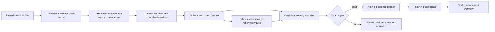

# CourtLoad baseline implementation handover

Status: **approved direction; implementation pending**. Prepared 2026-09-20 after repository inspection and an owner interview. Intended for the implementing AI agent, including Gemini Flash or Sol. This is an incremental build in the existing repository, not a rewrite.

## Start here

Build a useful NBA player comparison application on real historical data, with a reproducible data pipeline and an honest forecasting experiment. Complete the milestones below in order. Each milestone ends with observable acceptance evidence; a working UI alone does not establish completion.

Read this file first. Read [data and serving contracts](design/data-serving-contracts.md) before M1–M4, [product contract](design/product-contract.md) before M4/M7, and [evaluation protocol](design/evaluation-protocol.md) before M5–M6. The [source research](research/zero-cost-data-sources.md) is supporting evidence for M1, not proof that the full dataset is usable.

### Authority and settled decisions

The owner approved these decisions in the planning conversation:

| Decision | Baseline contract |
| --- | --- |
| Engineering emphasis | Backend/data engineering first, supported by rigorous evaluation and a polished public-style comparison workflow. |
| Budget | Zero additional spending. No paid API, trial-to-paid dependency, new hosting, GPU, or paid tooling requirement. |
| Data | A pinned free historical archive is the primary acquisition path, subject to validation. Preserve BALLDONTLIE as optional legacy functionality. |
| Experience | Historical replay with a prominent cutoff date is sufficient. Current-season updates are optional future work. |
| Deployment | A reproducible local application and recorded demonstration are required. Hosting on the existing Pi or Oracle VPS is optional. |
| Infrastructure | Owner reports an existing Oracle Ampere instance: 4 OCPU, 24 GB RAM, 200 GB aggregate block storage, shared with other work. These are total allocations, not resources reserved for CourtLoad. Pi capacity has not been audited. |
| Delivery | No fixed deadline. Deliver verified milestones; re-estimate after source validation. |
| Agent autonomy | Choose routine implementation details. Bring back paid commitments, changes to product scope, destructive migrations, or a different primary source. |
| Completion | Real comparisons, reproducible warehouse and experiment, failure tests, two case studies, and a demo. A challenger beating the baseline is not required. |

These decisions supersede the September 12 scope only where necessary: paid-provider-first acquisition, required live refresh, and hosting assumptions. The comparison scope, fixed scoring target, temporal discipline, and deferred fantasy features remain. See [ADR 0003](decisions/0003-zero-cost-historical-baseline.md).

Precedence: subsequent owner decisions → this handover and its contracts → [September 12 scope](portfolio-scope.md) → [course-correction roadmap](course-correction.md) → earlier docs. The external portfolio blueprint is at `/home/ethioking/dev/Caleb_Optimized_Portfolio_Project_Blueprint_v2.md`; `Portfolio_NBA_Distributed_Focused_Proposal.md` is historical discussion. Repository copies make this handover portable.

Old requirements for paid live ingestion, browser league setup, and two fantasy scoring weeks are superseded. Old evidence templates are not instructions to add extra models or features. Preserve historical results and deferred code.

### What exists, and what does not

Static inspection found the following. No application test suite was rerun during planning; historical README test counts are not new verification.

| Area | Reuse | Required change |
| --- | --- | --- |
| `src/courtload/ingestion/` | HTTP bounds, raw storage, validation, corrections | Add archive adapter and explicit missingness, external identity, observation and import contracts. |
| `models.py`, `migrations/` | SQLAlchemy/Alembic foundation | Add immutable dataset/source history and serving publication; preserve existing rows and private references. |
| `warehouse/` | dbt layering and grain tests | Replace mutable/current-time public calculations with dataset/cutoff-bound facts and marts. |
| `api/routers/public.py` | Public endpoints, health, lineage concepts | Serve published datasets, rich profiles, comparison, and actual evaluation results. |
| `services/recent_form.py` | Existing behavior and tests | Consolidate metric definitions with warehouse calculations. |
| `dashboard/` | Next.js app and basic styling | Player detail, comparison, replay controls, evaluation, and usable failure states. |
| Auth/fantasy/planner | Real existing implementation | Preserve and isolate from baseline navigation and completion gates. |
| Tests/operations | Python tests, CI, dbt, Compose, backup scripts | Add PostgreSQL behavior tests, browser workflow tests, complete artifact restore. |

Specific traps: ingestion commits pages into tables read directly by the API; no atomic publication exists. Raw-object deduplication loses repeated observation history, including A→B→A changes. Source stat nulls become zero. Missing tipoff times become midnight UTC. Three-point attempts are parsed but not stored. Existing point-in-time SQL shifts rows but does not enforce prior-day availability. ML and comparison pages are absent. Python integration fixtures use SQLite; checked-in frontend tests cover date helpers rather than the claimed component suite.

## Architecture and build boundaries

Keep one Python application, one PostgreSQL database, dbt, Next.js/TypeScript, and Docker Compose. Add a small scikit-learn experiment package. Filesystem artifact storage is sufficient. Public requests read persisted results; they do not download data, train models, or run dbt. Use a database run lock rather than a queue service. No Kafka, Spark, Airflow, Redis, Kubernetes, LLM commentary, or custom distributed system is needed.

Suggested module ownership, not a demand to move working files:

- `ingestion/archive.py`, `ingestion/normalization.py`: file acquisition/parsing and source-specific translation.
- `services/datasets.py`, `services/publication.py`: manifests, build state, locks, and publication.
- `warehouse/models/`: authoritative basketball facts, descriptive aggregates, dated features.
- `services/player_analytics.py`: bounded read/query assembly, without a second metric implementation.
- `evaluation/`: dataset export, chronological splits, baselines, challenger, calibration, reports.
- `api/schemas/` or existing schema location: typed public contracts; `dashboard/lib/` owns client types and formatting.

## Implementation milestones

### M0 — Preserve work and establish the baseline

Inspect `git status`, diffs, and current instructions before editing. There is substantial pre-existing modified/untracked work, including scope docs, UI, planner/config changes, tests and development scripts. Preserve it; do not reset, overwrite it wholesale, or claim it as newly implemented. Record the starting commit and dirty paths in `docs/implementation-progress.md` when implementation starts. Do not automatically commit all files.

Run the existing checks that can execute locally; record failures and prerequisites separately. Read package scripts rather than relying on historical version counts. Retain old public/private contracts while introducing the new public surface. Decide an additive migration path before touching identities.

**Exit:** starting state and genuine failures recorded; relevant existing behavior understood; this plan is linked from README; no unrelated work lost.

### M1 — Prove the free source

Use the pinned archive and exact file references in the research note. Download to ignored local storage with timeouts, byte limits, temporary files, and verified completion. Support importing already-downloaded files so normal rebuilds work without network access. Parse all player parts, then filter seasons; parts are not chronological partitions.

Produce `docs/evidence/historical-source-spike.md`: retrieval manifest, hashes, attribution, schema/missingness table, duplicate analysis, season/team coverage, reconciliation, and limitations. Provisionally target 2021-22, 2022-23, 2023-24. Select the final seasons only after inspecting coverage. Check regular-season inclusion against independently sourced season game counts/results; list exclusions such as the Cup final. A complete-looking row count is insufficient.

Validate at least 25 joined games spanning the chosen seasons plus a traded player, overtime, missing/zero minutes, and malformed/conflicting records. Do not require a real correction or DNP example to exist: document absence and use labeled fixtures for those contracts. Full selected-season checks remain necessary. Parse the same files twice and show stable normalized output; database import idempotency is established in M2.

**Exit:** essential fields and source identity work; usable season coverage is quantified; player points reconcile to team scores for admitted complete games; acquisition costs nothing; provenance is accurately attributed. If gaps prevent the core workflow, stop dependent data work and report the exact blocker. Continue independent fixture-backed infrastructure. Propose a replacement source only with evidence; never silently switch or relabel fixtures as real data.

### M2 — Version the data and make migration safe

Implement the observation, identity, dataset, and normalized-fact contracts. Preserve external IDs as strings under source namespaces. Add date precision, three-point attempts, explicit nullable fields, canonical checksums, and a quarantine report. Build immutable normalized versions from raw files and retain row-level locators.

Preserve existing internal keys and foreign keys. Backfill legacy identity mappings as belonging to their actual legacy source; ambiguous mixed fixture/provider data needs an audit, not a guessed mapping. Put the historical baseline in a separate configured database/Compose project if necessary to avoid contaminating an existing user database. This is not permission to drop existing data.

**Exit:** additive migration succeeds on empty and legacy seeded PostgreSQL databases; import twice is idempotent; A→B→A observations are recoverable; a failed import cannot become an accepted dataset; hashes link an admitted fact to its file and row. Existing planner/auth tests still pass where supported.

### M3 — Warehouse and atomic publication

Build complete player/game and team/game facts, historical participation, profile windows, opponent allowances, and dataset/cutoff-bound serving outputs. Implement the run lock and publication state machine in the data contract. Use ordinary tables indexed by immutable snapshot IDs; build candidate relations in a staging schema and copy validated outputs into append-only serving tables. Do not run destructive full-refresh dbt operations against currently served relations.

Run targeted PostgreSQL tests for concurrent builders, failed dbt/model publication, crash boundaries, consistent comparison reads, and rollback. Reconcile one real player's last-5, last-10 and season values to source rows by hand/calculator or an independent check.

**Exit:** all new public data can be read from one published snapshot; a failed candidate leaves the prior snapshot intact; no same-date outcome enters earlier features; shooting denominators and incomplete opponent context behave as specified.

### M4 — Deliver the first useful player page

Implement public search, player detail, historical date/season selection, recent/season summaries, minutes and attempts trends, game log, reconstructed next matchup, sample counts, and source labels. Wire real serving marts rather than duplicating formulas in React. Use fixtures for edge states and the accepted archive for reconciliation.

This milestone may display “Evaluation pending” with no estimate. It is a useful intermediate delivery, not baseline completion. Keep the later comparison/evaluation route designs in the product contract.

**Exit:** a user can find a real player, change the replay date, and explain a change in minutes/production from visible rows. Shared URLs reproduce the same dataset/cutoff. Browser tests cover search, date change, empty history, and unsupported date. No account setup is needed.

### M5 — Freeze the experiment and establish baselines

**Complete 2026-09-21.** The frozen config, accepted-dataset manifest, validation/calibration
runner, immutable artifacts, temporal tests and measured baseline evidence are recorded in
[baseline evaluation evidence](evidence/baseline-evaluation.md). S3 remains unopened for M6.

Implement the exact evaluation protocol. Freeze manifest, eligibility, date splits, feature set, seeds, tuning budget, calibration, metrics, and promotion thresholds in a versioned config before final testing. Implement last-10 and exponentially weighted baselines first. Export leakage-safe features and separate labels.

**Exit:** one offline command rebuilds baseline predictions and metrics from the frozen manifest; every row has a split/cutoff/history count; exclusions and fallback cases are counted; changed future rows leave earlier feature hashes unchanged. Final-test outcomes have not been used for tuning.

### M6 — Evaluate the challenger and context ablation

**Complete 2026-09-21.** The frozen grid, pre-open registration, one S3 final evaluation,
no-promotion decision and model card are recorded in
[M6 evaluation evidence](evidence/model-evaluation.md). EWMA remains the historical replay
policy. The M6 report did not capture a separate S3 observed-appearances-without-candidate
count; this coverage limitation is disclosed in the model card.

Implement one bounded gradient-boosted regressor in player-only and player-plus-context variants. Use the same eligible evaluation rows, preprocessing policy and tuning budget. Evaluate intervals, calendar-block uncertainty and predefined cohorts. Record promotion or no-promotion from frozen rules; a negative result is a successful experiment.

Write a machine-readable report and `docs/evidence/model-evaluation.md`. Preserve all candidate identities/results, including losing models. Generate replay estimates with artifacts trained/calibrated strictly before the replay cutoff; keep real forward prediction mode separate.

**Exit:** M5/M6 reproduce offline with recorded dependencies, seeds, artifact hashes and exact split dates; model card explains exclusions and historical reconstruction; no test-set retuning or retroactively “pregame” output exists.

### M7 — Complete comparison and evaluation views

**Complete 2026-09-21.** The shared-cutoff comparison API/UI, registered EWMA replay estimates,
empirical intervals, immutable evaluation endpoint, methodology and data-health presentation are
recorded in [M7 comparison and evaluation evidence](evidence/comparison-evaluation.md). Fixture
browser coverage exercises sparse and failed states; real archive captures verify two supported
players with different reconstructed next-game dates.

Implement the two-player response and UI, using one dataset, cutoff, formula and estimator policy. Add last-5/10/season comparison, role and opponent context, empirical intervals, prediction gap, and explicit insufficient-data states. Implement evaluation/methodology/data health views from real artifacts. Use human-readable labels in the main flow; technical manifests belong behind details links.

**Exit:** browser tests cover a complete comparison, swapped players, differing next-game dates, sparse history, stale/failed refresh, missing opponent context, missing estimates, and no promoted challenger. Both players remain consistent through a concurrent publication. Keyboard/mobile use is verified. No winner probability is invented from interval overlap.

### M8 — Reproducibility, failure recovery, and evidence

Provide documented commands for acquire/import, warehouse build, evaluate, publish, run, verify and restore. Command names proposed in the supporting contracts are targets to implement, not commands that already exist. Lock Python experiment dependencies and preserve the frontend lockfile. An imported dataset must rebuild without network or provider credentials; acquiring dependencies initially may require the internet.

Back up and restore database, raw files, manifests, model/evaluation artifacts and the published pointer together. Rebuild into a separate local database and verify artifact hashes and one comparison. Measure import/dbt/evaluation duration, disk/peak memory, and API latency using a pinned dataset, hardware description, warm-up, request mix, concurrency and error count. Report p50/p95 and sample counts, not guessed capacity or adoption.

Record two real-player case studies at explicit historical cutoffs: one role/form change and one comparison where uncertainty or context changes the interpretation. Choose examples from validation-era replay dates, not by cherry-picking final-test wins. Add a short screen recording showing search → context → compare → evaluation. State what remains unknown.

Rewrite README/status, source guidance, evidence index, operations docs and metadata around implemented behavior. Supersede old two-fantasy-week and paid-source gates. Preserve old fixture evidence as history. Update the portfolio blueprint separately only if the owner later requests portfolio-wide edits.

**Exit:** the definition of done below is fully evidenced; a new reader can run the project; failures are visible; no spending or remote deployment was necessary.

### M9 — Optional existing-infrastructure deployment

Only after M8, assess available capacity on the owner-selected Pi/VPS. Use ARM64-compatible builds where needed. Keep training/backfill off the shared host initially; deploy prebuilt artifacts and read-only serving workloads. Apply measured memory/CPU/disk limits with headroom for existing services. Use the existing reverse proxy/TLS arrangement if publicly exposed; no new cloud resources or paid domain are required.

Bind database/admin access privately, configure production secrets, disable demo registration/seeding and optionally legacy fantasy routes, and verify backup/restore. Public reads should serve derived analytics rather than a raw downloadable mirror. Recheck intended distribution against source documentation before publication. Do not change LineWatchTO or Doorlink deployment configuration as part of CourtLoad setup.

**Exit if selected:** deployment smoke and resource evidence. Otherwise mark this milestone “optional, not attempted”; M8 still completes the baseline.

## Verification and definition of done

Run existing Ruff, mypy, pytest, frontend lint/typecheck/test/build, dbt and smoke checks appropriate to changed code. Discover exact invocations in `pyproject.toml`, `dashboard/package.json`, Makefile and CI. Add browser and PostgreSQL checks to CI; keep bulk real data and network-dependent source checks outside routine CI. Tiny fictional fixtures must exercise the same normalized contracts.

All required boxes need evidence links in the implementation progress file:

- [x] Free source passes M1; selected seasons, provenance limitations, hashes and row counts recorded ([historical source spike](evidence/historical-source-spike.md)).
- [x] Corrected/repeated/failed imports preserve lineage and stable identities ([raw import lineage](evidence/raw-import-lineage.md)).
- [x] Warehouse facts and profiles reconcile; future/same-day data cannot leak into prior features ([real-player analytics](evidence/real-player-analytics.md)).
- [x] Published snapshots remain consistent through failed/concurrent refreshes and restore ([serving and publication](evidence/serving-and-publication.md), [performance & restore](evidence/performance.md)).
- [x] Real player detail and two-player historical comparison work without authentication ([real-player analytics](evidence/real-player-analytics.md), [comparison and evaluation](evidence/comparison-evaluation.md)).
- [x] Baselines, challenger and context ablation are completed with an untouched final test ([baseline evaluation](evidence/baseline-evaluation.md), [model evaluation](evidence/model-evaluation.md)).
- [x] Intervals, coverage, exclusions and promotion/no-promotion are documented honestly ([model evaluation](evidence/model-evaluation.md)).
- [x] Real-data and fixture classifications remain separate; replay is visibly historical ([comparison and evaluation](evidence/comparison-evaluation.md), [case studies](evidence/case-studies.md)).
- [x] Two case studies, a demo recording, reproducibility instructions and measured performance exist ([case studies](evidence/case-studies.md), [performance benchmarks](evidence/performance.md), [demo recording](assets/demo.webm), [runbook](operations/runbook.md)).
- [x] Existing work is preserved; applicable checks pass, with limitations explicitly recorded ([implementation progress](implementation-progress.md)).

## Working protocol for the implementing agent

Work on one milestone at a time, in small vertical changes. Update `docs/implementation-progress.md` after each milestone with implemented behavior, changed paths, command/results, evidence links, unresolved blockers and next action. Mark fixture verification, real-data verification and untested behavior separately. Do not infer completion from test count or an attractive screenshot.

Make routine mechanical choices autonomously within these contracts. If a contract proves infeasible, record the evidence and propose the smallest adjustment. Dataset acceptance is an engineering gate the agent can complete; it is not a request to ask the owner to verify data manually. Actual new costs, replacement source, destructive changes or broader product scope require the owner's decision.

For a fresh agent session, use:

> Implement the CourtLoad baseline described in `docs/implementation-plan.md`. Read the progress file if present, inspect the current working tree, then complete the next unfinished milestone and its acceptance checks. Read each linked contract when its milestone requires it. Preserve unrelated work. Do not stop at scaffolding or substitute fixture success for real-data evidence. Record results and continue through the authorized baseline; optional remote hosting is not a prerequisite.

After M8, iterate from observed user confusion, model error, source gaps, or operational measurements. Future candidates are fresher free data, true pregame logging, better coverage and optional hosting. Fantasy integrations, tactical analysis, multiple targets/sports and new infrastructure remain separate scope decisions.
