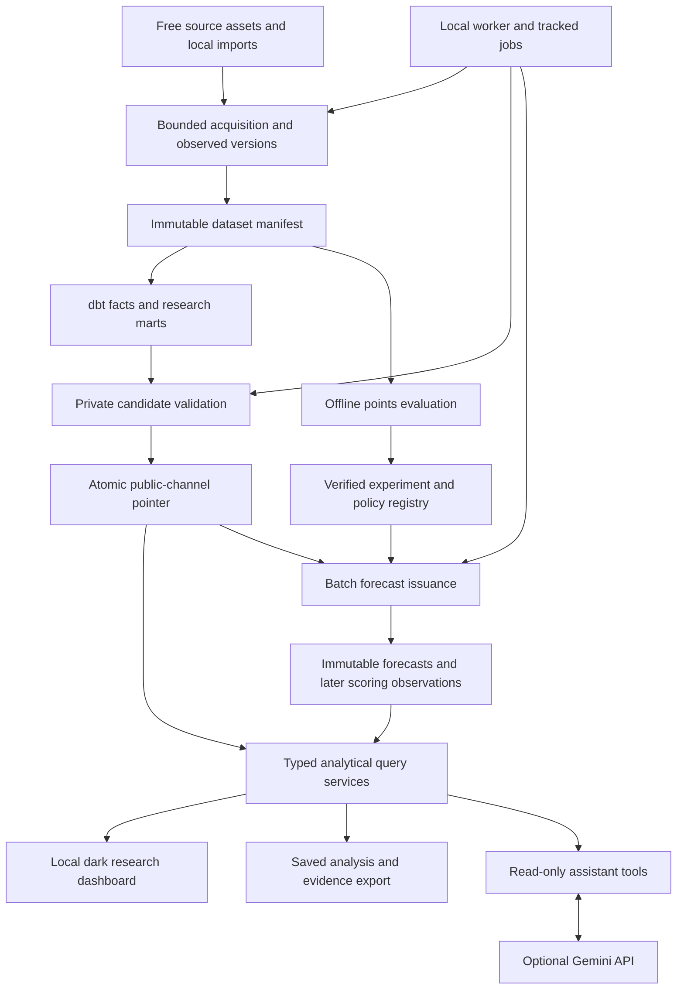

# CourtLoad local research workbench: implementation handoff

Prepared 2026-10-01 for Gemini 3.8 Flash. Status: **owner-approved direction; implementation pending**. This document specifies the next release. Inspection and source sampling informed it; application checks were not rerun during planning.

Subsequent product handoff: the owner-confirmed [Databallr replica plan](databallr-replica-implementation-plan.md) supersedes this document's narrower feature/layout scope. Read it for new UI/search/richer analytics/finance/Live work. Retain this handoff and linked contracts for preserved behavior, temporal/integrity rules and sealed experiments; do not restart these milestones or infer completion from their prose.

## Start here

Build CourtLoad into a local NBA research and forecast workbench. A user should be able to investigate a player or team, inspect a next-game points estimate where eligible, and save enough evidence to reproduce the analysis. The main product works without an LLM, paid data access, or public hosting.

Implement in this repository, preserving the completed historical experiment and legacy functionality. Begin with P0 below. Each milestone ends with measured acceptance evidence. Update a new `docs/workbench-implementation-progress.md` as work proceeds; leave the historical M0–M8 log intact.

Read the following references at the corresponding milestone:

| Work | Required reference |
| --- | --- |
| Source admission and ingestion, P1–P2 | [Source findings](research/workbench-source-findings.md), [data contracts](design/workbench-data-contracts.md) |
| Warehouse, query services, jobs, P2–P4 | [Data contracts](design/workbench-data-contracts.md) |
| Application shell, analytics, portraits, P4–P5 | [Interface contract](design/workbench-interface-contract.md) |
| New points experiment and issuance, P6–P7 | [Points evaluation protocol](design/points-forecast-protocol.md) |
| Optional assistant, P8 | Assistant section of the [data contracts](design/workbench-data-contracts.md) |
| Final evidence and packaging, P9 | Release checklist in this document |

The owner's current decisions supersede earlier public-product framing, historical-only scope, fixed composite target as the primary experience, and the prohibition on an optional LLM layer. Existing temporal, missingness, immutability, and safe-publication rules remain binding. Older plans describe the completed historical baseline. Do not execute their milestones again as new work.

## Product decisions

| Decision | Next-release requirement |
| --- | --- |
| Portfolio emphasis | Data engineering, ML engineering, and data science, in that order. |
| Primary user | A technically curious NBA analyst working locally. No registration or fantasy-league setup in the main path. |
| Main job | Filter and compare players or teams, investigate changing production, and reproduce an evidence-backed finding. |
| Forecast job | Explore a registered next-game **basketball points** experiment and its errors; eligible current estimates are conditional on appearing. |
| Data | Admit recent completed seasons and enable daily current-season batch refresh. Treat freshness as a verified capability, not a marketing claim. |
| Phases | Regular season by default. Separate preseason research. Retain postseason facts under their phase; playoff and Summer League modeling are deferred. |
| Presentation | Dark theme first, compact application shell, functional tables and charts, shared analytical context. |
| Identity | Black favicon with an orange basketball/CourtLoad mark. Best-effort player portraits with a measured coverage report and placeholders. |
| AI | Optional Gemini adapter using the owner's API key; bounded read-only analytical tools and evidence-backed result cards. Ordinary search remains complete. |
| Deployment | Reproducible local Compose deployment. Daily refresh runs while the local worker is running, with catch-up after downtime. |
| Budget | Core operation has no paid dependency. Optional cloud AI uses the user's account and may have provider charges; it is disabled until configured. |
| Completion | A bounded, tested release. No requirement for a challenger to beat the baseline. Team conference forecasting and richer defensive impact models are later projects. |

Competition phase is a domain dimension, not an importance score. Playoffs have different opponents, selection, rotations, and scheduling. Summer League is a different competition and can answer rookie-development questions. No manually assigned universal weights or automatic mixing belong in this release.

Three flagship demonstrations define the product:

1. **Player investigation:** select a player, cutoff, and season; inspect minutes, attempts, points and efficiency; compare a peer; save the analysis and trace one number to source rows.
2. **Raptors research:** inspect a season-scoped Toronto cohort and team record; sort named defensive box-score metrics with minimum-sample filters. Explain what those metrics measure without claiming an overall best defender.
3. **Forecast investigation:** inspect the points baseline/challenger results, calibration and error slices; replay a stored estimate; later inspect an actually issued forecast and its observed outcome.

## Architecture

Keep Python/FastAPI, PostgreSQL 17, dbt, scikit-learn, Next.js/TypeScript, and responsive vanilla CSS. Use the installed frontend version and its bundled documentation: `dashboard/package.json` currently specifies Next.js 16, despite older prose describing 15. Follow `dashboard/AGENTS.md` before frontend code changes.

One Python worker and a PostgreSQL job table are sufficient. Filesystem content-addressed storage is sufficient. Model training is an explicit offline CLI operation. Reads and AI tools query published analytical services; they never start downloads, dbt builds, or training.

`public` is the existing publication channel name. Retain it: it identifies a database pointer, not a commitment to internet hosting. Publish one coherent release manifest that binds player, team, schedule and identity inputs. Availability can differ across capabilities, but each displayed result must identify its actual inputs.

## Repository findings that determine the work

These are code-inspection findings, not new runtime verification:

| Existing area | Reuse | Gap to close |
| --- | --- | --- |
| `ingestion/archive.py`, `archive_import.py`, `archive_models.py` | Bounded downloads, normalized versions, observations, membership and quarantine | Generalize through a new adapter and contracts; retain the sealed archive parser unchanged. |
| `services/publication.py`, `warehouse_models.py` | Private candidate schemas, dedicated advisory-lock connection, pointer swap and rollback | General research and fresh schedules; coordinated worker lock; timeout and interruption recovery. |
| Archive profile mart | Prior-day player windows | Profile existence requires a recent same-season appearance and upcoming target. Research must work independently of a forecast. |
| `services/player_analytics.py` | Snapshot resolution, game logs and lineage | Add browsing, team/stat filters, metric definitions, general profiles, team summaries and saved investigations. |
| `evaluation/`, old config/artifacts | Chronological evaluation, baselines, challenger, calibration, immutable reports | New points target and portable registration; no edits to the sealed composite experiment. |
| `replay_estimates.py`, `evaluation_public.py`, `backup_restore.py` | Hash checking and registered historical evidence | Hardcoded original snapshot/run identities prevent general fresh-install use. |
| `/api/data-status`, `/models/runs` | Legacy functionality | Main status reads BALLDONTLIE tables; model listing is a placeholder. New views need real archive/workbench status. |
| Dashboard | Search, compare, trends, evaluation, accessibility | Homepage/footer still emphasize fantasy; large light-theme sections waste working space. |
| Operations/tests | Compose, static checks, fixtures, PostgreSQL tests | Empty Compose startup has no populated analytics bootstrap; DB tests can skip; browser tests use a mock server. |

The old player dataset admits 3,511 games and excludes 179 games. Raw team outcomes cover complete seasons. Keep team and player quality contracts separate so a malformed player minute cannot remove a valid team result from team research. Reconciliation failures still affect any capability that depends on complete player totals.

## Ordered implementation milestones

### P0 — Preserve evidence and establish executable checks

Record the starting revision, dirty paths, available database/runtime, and baseline results. Inspect actual package scripts. Preserve the original configs, accepted manifest, model card, and M5/M6 artifacts byte-for-byte. Add a checksum inventory for retained evidence.

Correct the verification setup: give PostgreSQL tests `COURTLOAD_TEST_POSTGRES_URL` in CI; make critical DB-test skips fail the verification job; plan a real-service browser suite alongside useful mocks. Make DB behavior tests create their own small inputs/artifacts rather than depend on the owner's populated database or ignored M6 files. Retain real-archive checks as a separately documented integration run. The dashboard unit script currently runs only `lib`; extend discovery when component tests are added. Record existing failures without relabeling them as new regressions.

**Targets:** `.github/workflows/ci.yml`, `tests/integration/`, dashboard test configuration, new progress log.

**Done:** repeatable check commands and prerequisites are recorded; PostgreSQL tests demonstrably execute; retained evidence hashes are unchanged. No product feature is claimed complete from this milestone.

### P1 — Admit the recent free source and its capabilities

Use SportsDataverse NBA Stats player/team bulk releases as the preferred recent source, and its raw NBA schedule mirror for the current schedule. The candidate has downloadable 2024–25 and 2025–26 player data with NBA identities. Release URLs are mutable; every acquired byte stream becomes an immutable local artifact. Follow the source reference for verified URLs and limitations.

Build `scripts/workbench_source_spike.py` and a source contract/config. Read entire selected player/team datasets for quality checks. Initially acquire enough seasons for the points protocol, subject to validated coverage. Reconcile duplicate grains, team sides, final scores, made/attempted counts, minutes, DNP/missingness, phases and season numbering. Report every excluded game and its effect on each capability. Validate current schedule rows independently from completed box scores.

Explicitly check current-season player-box and current-team-association availability. Preseason schedules are available; preseason player outcomes need an additional verified acquisition path. An optional ESPN preseason adapter is permitted after source and identity validation. Current roster data is a separate gate; old roster files do not prove current membership.

**Targets:** new `ingestion/sportsdataverse.py` and normalization module, source config, source-spike script, unit fixtures, `docs/evidence/workbench-source-spike.md`.

**Done:** real recent data passes documented admission checks; source/phase capabilities and unknowns are recorded; repeated parsing yields stable normalized hashes; no paid access is required. Current outcomes can legitimately be empty before the season begins. Fresh daily ingestion remains unverified until different in-season observations exist; report that distinction.

### P2 — Add versioned fresh-data and portable identity contracts

Implement additive tables described in the data contract. Keep source identity, canonical NBA identity, acquired observations, normalized versions and dataset membership distinct. Store schedule versions separately from outcomes. Preserve unknowns. Seal dataset memberships and published analytical rows against ordinary application mutation.

Register legacy M6 as a retained experiment without rewriting its original provenance. Add portable content/transform signatures and explicit equivalence bindings for rebuilt local snapshots. New experiments reference semantic manifests and separate local installation IDs. An equivalence check must reject changed facts, transforms, features or calibration; UUID differences alone should not prevent authorized reproduction.

**Targets:** additive Alembic migration(s), `archive_models.py` or new focused workbench models, `warehouse_models.py`, registry/manifest service, existing evaluation-serving/restore seams.

**Done:** A→B→A corrections preserve all observations; identical content is reusable without losing observation order; fresh-database rebuilds use new local UUIDs and can register verified compatible evidence; invalid mutation/membership attempts fail. Sealed historical artifact hashes remain unchanged.

### P3 — Build research marts and the shared query layer

Create general player and team research facts/marts independent of target-game eligibility. Implement one versioned metric catalog and typed query specification. Support browsing without a name, substring name search, season/phase/team/window filters, minimum games/minutes, sortable metrics, deterministic pagination and game logs. Existing substring search should remain compatible for old clients.

Team filters use observed participation for the selected season/window. A separate current-roster view requires admitted roster evidence. Default percentages use summed makes/attempts. Defensive output is named box-score statistics, not an inferred impact rating. Team records require valid final outcomes and independent team admission; ties in record ordering do not establish official conference placement.

Implement save/reproduce/export for bounded investigations: a manifest, query, input identity, metric version and result hash. Save full eligible ranking results within configured bounds, so the exported finding is reproducible beyond the visible page. Preserve each analysis when new data arrives.

**Targets:** new dbt workbench staging/facts/marts and schema tests; analytical service and schemas; new `/api/workbench` router; analysis storage/export; query contract tests.

**Done:** two real players, a traded player, Toronto, insufficient-history cases and a player with no upcoming target all return reconciled research results. UI/API/AI use the same formulas. Saved results reproduce against their bound inputs; mismatched query cursors and unsupported metrics are rejected.

### P4 — Add the local worker, bootstrap and daily refresh

Add a single worker service and tracked, allowlisted jobs. Use the existing PostgreSQL lock identity for all coordinated acquisition/import/build/publication mutations. Refactor publication into a wrapper that acquires the lock and an internal primitive used by a worker already holding it; reacquiring from a second connection would reject its own job.

Implement bootstrap, refresh and optional portrait acquisition. Training remains CLI-only. Refresh prepares and validates a candidate, computes eligible batch forecasts from a registered policy, then publishes a coherent release. Missing forecasts do not block valid descriptive data. Track input/result identities, stage, heartbeat, timings and bounded sanitized errors.

At P4, forecast capability can be `no_policy_registered`; P6–P7 add the actual experiment and issuance stage. Bootstrap initially populates recent research and schedules. Document the separate explicit evaluation/activation command sequence for forecast research; a startup request must not train a model implicitly.

Schedule a configurable daily refresh after the upstream build window; start with 09:00 UTC. Catch up once on startup when due, and expose Refresh now. A sleeping or powered-off computer cannot refresh. Future schedule placeholders and offseason inactivity are valid states. A failed source or build retains the prior good release.

Bind default Compose ports to loopback. Browser mutations use a same-origin server route; protected operator credentials stay on the server. Read-only analytics remain usable without user accounts.

**Targets:** worker/job service, CLI, config, `Dockerfile`/worker image dependencies and mounted artifact roots, `docker-compose.yml`, `.env.example`, operator API/proxy, `scripts/smoke.sh`, job/lock PostgreSQL tests.

**Done:** a fresh Compose installation can bootstrap populated recent research data without manually copying a local database; repeated bootstrap is idempotent; overlapping refreshes produce one owner; interruption is recoverable; failed candidates leave the pointer unchanged; browser requests return a job ID promptly. Smoke asserts populated analytics, not just HTTP health.

### P5 — Ship the dense dark research application and portraits

Implement the application shell and routes in the interface contract. Start with `/` as Research overview, then player explorer/detail, teams/detail, comparison, forecasts/evaluation, Data & pipelines, saved investigations, and settings/methodology. Primary navigation must open working application views. Preserve deferred planner routes while removing them from the main product story.

Use the same context bar across analytics: source release, season, phase, before-date cutoff and window. Separate last-season reference context from current-season statistics. Build functional filters, sorting, keyboard search, row actions, charts with data tables, lineage inspection and analysis export. Show meaningful loading/unavailable states from API responses.

Add the favicon and best-effort portrait registry/cache. Portrait fetching is independent of statistics publication and model hashes. Use NBA identities, attribution and local content hashes; existing cache and neutral placeholders keep pages useful offline. Measure coverage rather than promise every player has a photo.

**Targets:** dashboard layout/CSS/metadata, shell/context/table/chart/portrait components, route pages and API client/types; asset service and favicon files.

**Done:** all flagship research steps work with real data; screenshots demonstrate dense desktop and usable narrow layouts; keyboard access, contrast and chart alternatives are checked; no synthetic decorative chart remains on the main dashboard. Broken/missing portraits never block search or analysis.

### P6 — Complete the new points forecasting experiment

Implement the separate points-v1 experiment exactly as prescribed in the protocol. Reuse evaluation utilities through explicit target interfaces; keep the old frozen config loader valid. Compare fixed rolling baselines, a preregistered early-season carryover baseline and a small player-only/context challenger. Freeze splits, eligibility, tuning budget, calibration and promotion gates before opening the final season.

Model training and final-test execution are explicit stages. Persist features separately from labels, metrics, exclusions, forecasts, policy identities and reproducibility metadata. Expose experiment runs through a real registry. Publish the full result and serve the eligible baseline when the challenger fails.

**Targets:** new points config/target/candidate exports, reusable evaluation interfaces, registry/artifacts, CLI commands, protocol-focused tests, model card.

**Done:** the same frozen input reproduces memberships/predictions within declared tolerances; out-of-time errors, coverage, slices and candidate exclusions are published; source additions have not overwritten M6. A model beating its baseline is not a completion gate.

### P7 — Issue and score genuine prospective forecasts

Persist actual forecast issuance against observed inputs, schedule/team evidence and a previously activated policy. Eligibility requires strictly earlier game dates and input observations available at issuance. Each forecast stores its features and model/calibration versions. Later outcomes and corrections append scoring observations; they do not rewrite the issuance.

Serve explicit availability reasons at the season opener, on trades, for rookies and when coverage is stale. Last-season context remains research context unless a registered carryover policy is eligible. Keep historical reconstruction and genuine prospective forecasts clearly distinct.

**Targets:** forecast ledger/scoring tables and services, worker stage, forecast API, dashboard forecast/individual estimate views, issuance temporal tests.

**Done:** changing future facts or applying a late correction leaves old forecast hashes unchanged; scheduled zero scores never become labels; dates/time zones and schedule revisions are tested; production can log eligible forecasts. Before real season outcomes arrive, report prospective accuracy as **not yet observed**. Simulated lifecycle tests establish behavior, not future accuracy.

### P8 — Add the optional tool-backed assistant

Implement one Gemini provider adapter using the current official SDK and configurable model. Accept server environment configuration for the user's key; the UI shows configuration status and setup instructions. Keep the key out of client bundles, saved analyses, exports and logs.

Expose only the read-only tools in the data contract. Pin the analytical context for each question, validate arguments, bound rounds/rows/tokens/time, and render quantitative claims from verified tool evidence. Return organized result cards with an Open in explorer action and the same reproducible analysis manifest used by manual queries.

Supported demonstrations include a metric-specific Toronto ranking and an explanation of a registered player's points forecast. An overall defensive ranking or conference forecast must return a supported alternative or explicit unavailable explanation. Provider unavailability leaves ordinary search fully usable.

**Targets:** assistant service/provider/tool schema, server API, assistant panel, status/config, offline contract fixtures and a bounded optional real-key smoke.

**Done:** deterministic tool tests reject invented metrics, dates and SQL; every displayed number has a verified evidence reference; unsupported requests cannot produce invented projections; missing key, quota, invalid response and timeout states are usable. Real API tests are opt-in and never required by CI.

### P9 — Package evidence, recovery and the resume demonstration

Extend backup/restore to the manifest-referenced current raw inputs, evaluation configs/artifacts, saved investigations and forecast records. Coordinate capture with the mutation lock. Media may be included or treated as a rebuildable cache with recorded exclusions. Verify bundle hashes and restore into a fresh disposable database; check the expected channel/release and evidence relationships. Avoid automatically deleting retained evidence.

Record actual acquisition/import/dbt/forecast timings, storage growth, API latency, query/AI budgets and hardware. Verify meaningful real-service browser workflows. Update README, product metadata and operations docs to the implemented local-tool experience; mark source and model limitations honestly. Record a short demo and the three case studies.

**Targets:** backup/restore services/scripts/tests, benchmark/smoke/browser workflow, README, runbook, current evidence index and demo artifacts.

**Done:** the release checklist below is evidenced. Demonstrations use real admitted data with visible cutoffs. Resume claims use measurements from this release.

## Verification and release checklist

Run the actual repository commands for Ruff/format, strict mypy, pytest, dashboard lint/types/unit/browser/build, dbt and Compose validation. Use the Python virtual environment and a disposable PostgreSQL database. Include a real FastAPI/PostgreSQL browser run in addition to fixture-driven UI tests. Record unexpected warnings; the requested quality gate is zero warnings in checks.

- Fresh local bootstrap is populated, documented and idempotent; cached inputs support rebuilding without acquiring them again.
- Recent completed-season data and current schedules are validated; freshness distinguishes local acquisition, upstream update and outcome coverage.
- Daily worker/catch-up works; actual in-season observation evidence is recorded when available, and absent evidence is clearly labeled.
- Phase-specific research works for admitted data; unavailable preseason outcomes are identified by capability rather than fabricated.
- Player/team filters, comparisons, plots, source tracing and saved investigation export share one analytical definition.
- Dense dark desktop and narrow layouts, favicon, keyboard navigation, loading states and portrait fallback work.
- Points experiment is completed with chronological metrics and an honest promotion decision; sealed composite evidence survives unchanged.
- Prospective issuance and later scoring preserve original evidence; unobserved prospective accuracy is not invented.
- Optional AI returns bounded, supported, evidence-backed answers; the main application passes with AI disabled.
- Critical PostgreSQL tests execute, real-service browser checks pass, and a fresh-database backup restore is verified.
- The three case studies, demo, source report and measured performance/storage evidence exist.

If a free source stops updating, retain useful historical operation and mark the affected freshness gate incomplete. Continue independent work. Report the exact failed capability before proposing a paid dependency or silently reducing scope.

## Handoff and scope control

Use one reviewable milestone at a time. At each completion, record changes, check commands/results, real-data evidence, outstanding limits and the next prerequisite. Implement routine details autonomously within these contracts. Changed sources may be admitted when they satisfy the documented zero-cost contracts; record why. Bring scope changes, paid commitments and destructive operations back to the owner. Publishing to the internet is outside this handoff.

The release excludes conference-placement prediction, injury/appearance prediction, tactical or causal defensive impact, betting, automatic start/sit decisions, league transactions, play-by-play/on-off models, Summer League models, a light theme, unrestricted AI SQL and a vector database. Keep additional ideas in a future-work list tied to observed needs.

Suggested resume evidence, with placeholders replaced only after measurement:

- Built a local NBA research workbench using Python, PostgreSQL and dbt, versioning [N] player-game records and exposing reproducible player/team investigations with source lineage.
- Evaluated next-game points baselines and boosted challengers with chronological holdouts, reporting [MAE], [interval coverage] and supported error slices; implemented immutable prospective forecast logging.
- Added optional natural-language analytics over validated read-only tools, with numerical evidence references and [measured supported-query success] while retaining independent structured search.
